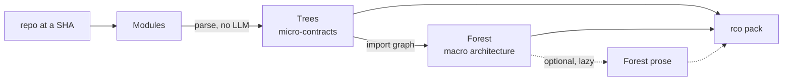
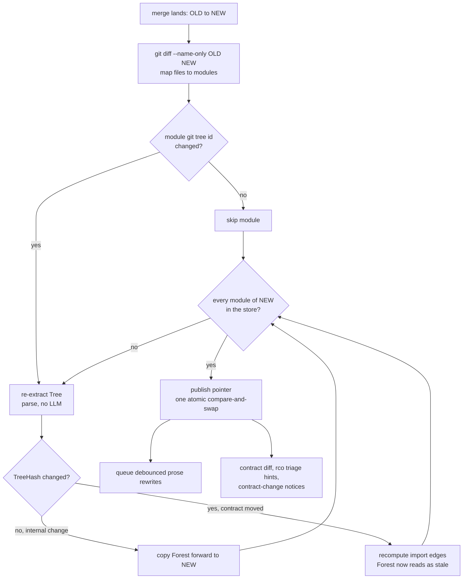
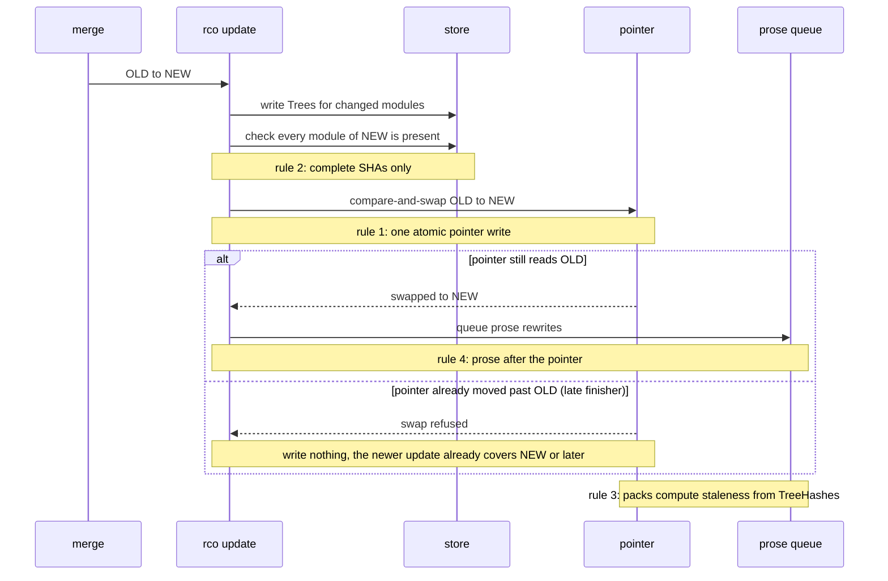
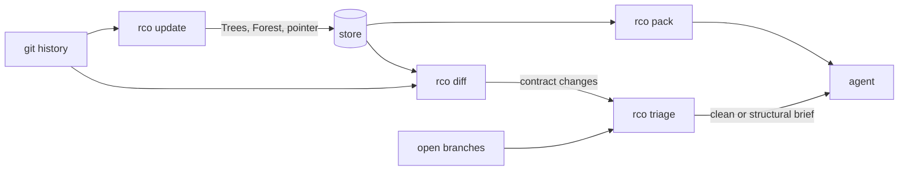
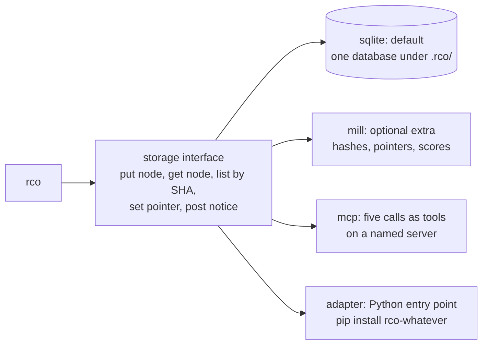
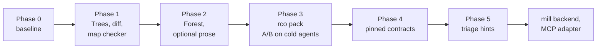
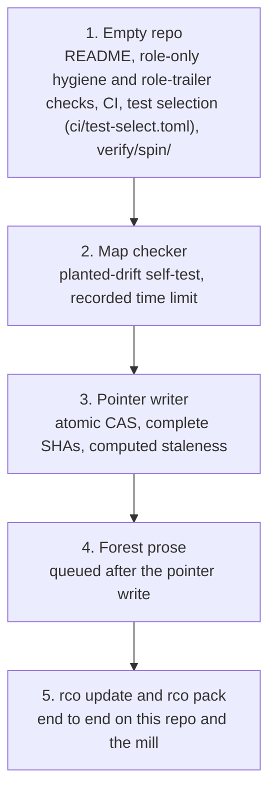
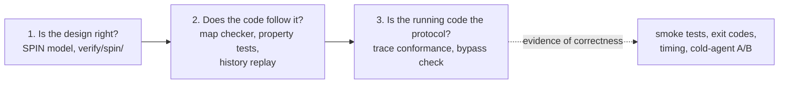

# repo-context-optimizer

Deterministic repo context for coding agents: contract Trees, an architecture Forest, contract diffs, and rebase triage. The goal is to replace LLM tokens with code wherever a contract can be computed.

**Status:** This is 0.1.8. 0.1.1 was merged but never tagged or published to PyPI, so 0.1.2 was the first install after 0.1.0 and carried both. `pip install repo-context-optimizer` installs the `rco` command. Everything in it is deterministic: the LLM prose path is off, and mined or derived prose fills in. `rco triage`, `rco notice`, `rco plan`, and `rco affected` are hints only (they never rebase, push, or block). The cold-agent A/B that counts waits until this install is the one under test. 0.1.8 tightens `rco pack --for` (imported files only, a scaled budget, tiktoken `o200k_base` when installed), and replay and metrics count importers of a changed public signature on the without-rco side. See [What ships](#what-ships) for what works and what is still design.

Builder and grok-tui split the development work, Auditor checks the design and models, and Validator passes and merges each PR.

### If you are an agent

Run `rco pack --for <files you will touch>`.
Read the pack.
Open raw files only on demand.

## What ships

| Code | Capability | 0.1.8 |
|---|---|---|
| TR, FO, PK, DF, CK, UP | `rco tree`, `forest`, `pack`, `diff`, `check`, `update` | shipped |
| PN, DR, TG, NT | `rco pin`, `drift`, `triage`, `notice` | shipped |
| LG | bundled parsers for JavaScript/TypeScript, Go, Rust, Java, PHP, shell, and PowerShell | shipped |
| MO | modules from `rco.toml`, then `package.json` / `Cargo.toml`, then directories | shipped |
| CF | `rco.toml` settings and backend choice (`sqlite` or an entry point adapter) | shipped |
| SS | a store cached across CI runs | shipped |
| SG | `rco diff --staged` / `--worktree` | shipped |
| TS | `rco affected`: test selection from a diff | shipped |
| IN | `rco init`: config, CI workflow, and hook setup | shipped |
| AG | `rco init --agents`: a marked block that points agent instruction files at `rco pack` | shipped |
| EV | `.rco/events.jsonl`: one line per run, once `.rco/` exists | shipped |
| FR | `rco pack` names its commit and says how far HEAD has moved | shipped |
| RP | `rco replay`: a labelled before/after estimate on your own history | shipped (an estimate, not an agent measurement) |
| MX | `rco metrics measure`, `summary` and `bypass` | shipped |
| HK | post-merge hook trigger for `rco update` | shipped (a merge webhook needs your own server) |
| RO | `rco live`: check against a schema dump, OpenAPI, or `--help` | shipped |
| LP | LLM prose | not shipped; off by design |
| MB | mill backend extra | not shipped |
| NM | notices sent by mail through a backend | not shipped |
| TW | `tw rco update` recorded runs | not shipped |
| MC | MCP backend | not shipped |
| MP | `rco plan`: simple merge planning across branches | shipped (simple; a plan only, never merges; [the rest is a proposal](#merge-planning-beyond-rco-plan)) |

## Why

Cold-start agents waste tokens rediscovering a repository: they read too many files, guess at module boundaries, and re-learn contracts that code already knows. Parallel agents on a busy repo pay again in rebase churn, often rereading full diffs when only a contract changed, or waking an agent when no contract they use has moved.

RCO's rule: **if code can compute it, code computes it.** CPU, memory, and disk are cheaper than tokens. LLM use is minimized and optional. `rco` is designed to work with zero tokens.

## Just works

The default in 0.1.8:

```
pip install repo-context-optimizer   # installs the `rco` command
cd any-git-repo
rco pack                   # SHA=HEAD; no --for: whole-repo Forest only; --budget 12000
rco pack --for src/cli.py  # owner + one-hop Forest lines, Trees of imported files, one import hop;
                           # one "nothing to add" line when nothing worth outlining is imported
rco diff                   # BASE=merge-base(default branch, HEAD); HEAD=HEAD
```

Does it help on your repo? One command, no setup, no agent, and it edits no file:

```
pip install "repo-context-optimizer[tokens]"   # adds tiktoken for real token counts
cd your-repo
rco replay                 # replays your last 10 code commits: with vs without rco
```

It prints tokens and file reads with and without rco for each commit, the medians, and its method and limits. It is an estimate, not a measurement of an agent, and it says so plainly when rco does not win. With `.rco/` present it appends its one line to the [events log](#events-log), like every rco run; without `.rco/` nothing is written. See [`rco replay`](#rco-replay---last-n---since-date---budget-n---max-files-n).

`--budget` is in tokens: tiktoken `o200k_base` when the `tokens` extra is installed, otherwise characters / 3.5, rounded up. The design default is 12000. `--for` is optional. These defaults match the [Commands](#commands) section.

Zero config is the goal: the SQLite backend is the default, with no `rco.toml` required. Cache lives in SQLite under `.rco/`, which rco adds to `.git/info/exclude`, never to `.gitignore`. Modules are detected automatically. Parsers for Python, SQL, JavaScript and TypeScript, Go, Rust, Java, PHP, shell, and PowerShell come bundled. An unknown language falls back to a file outline instead of an error. No LLM, keys, or network are required.

`rco.toml`, other backends, adapters, and MCP are all opt-in. If a configured backend is not installed, rco exits 2 and names it; it never silently switches to another store.

### Acceptance tests (zero-config goal)

| Repo | Expected behavior |
|---|---|
| Small Python repo | Modules detected from the package layout; Trees extracted; `rco pack` and `rco diff` run with the defaults above. |
| Polyglot repo | Bundled parsers used where available; unknown languages fall back to a file outline, not an error. |
| Large monorepo | Pack respects `--budget`; `rco update` re-extracts only modules whose tree ids changed. Cost and hit rate are Phase 0 measurements. |
| Repo with submodules | Submodules are skipped, with a note in the output. |
| LFS repo | LFS pointer files are treated as opaque: not fetched, not parsed as the real blob. |
| Empty repo | Empty pack and tree, exit 0, including a repo with no commits. |

## Concepts



### Module

A module is a logical unit of the repo, not necessarily a directory.

Detection order, shipped today:

1. A checked-in override file (`rco.toml`) can pin boundaries; the detector only falls back where that file is silent.
2. Language manifests: a `package.json` owns the JS/TS files under it, and a `Cargo.toml` with a `[package]` table owns the Rust files under it. Each manifest stops at the next nested one, and files in other languages there stay at the directory grain.
3. Directory fallback for whatever remains. Python files keep the directory grain (one module per package directory). Go packages are already directories.

`pyproject.toml`, `go.mod`, `pom.xml`, and similar are not used as module roots. Import-graph clustering (community detection on the import graph) is not built yet. Size caps on the directory fallback are not built yet. Every file maps to exactly one module, so the "file in no module" check passes by construction.

The override file is `rco.toml` at the repo root, read at the same commit as the code:

```toml
[[module]]
id = "frontend"
paths = ["web/**", "shared/**/*.ts"]
```

The first rule whose glob matches a path owns it. `*` and `?` stay inside one path segment, and `**` spans segments. A bad entry (no `id`, no `paths`, invalid TOML) becomes a note in the output, never an error.

### Tree (micro-contracts)

A Tree is a deterministic contract extracted from a module. It is never written by an LLM.

- **Code contracts:** language-native skeletons with function and method bodies stripped, via Python's `ast` module and bundled deterministic scanners for JavaScript and TypeScript, Go, Rust, Java, PHP, shell, and PowerShell (no tree-sitter or other dependency). Public classes and functions, signatures, type hints, the first docstring or comment line, constants, and `__all__` (or the language's equivalent: JS/TS exports, Go capitalized names, Rust `pub`, Java `public` and `protected`, PHP not `private`).
- **Non-code contracts,** which often matter more across a repo than signatures alone: CLI commands and flags, SQL schema tables and columns, HTTP routes, and message or event shapes.

Output is canonical (sorted JSON, no line numbers), so identical input always yields byte-identical output. The Tree hash is the sha256 of that JSON.

### Forest (macro architecture)

A Forest describes how modules fit together. Most of it is computed, not generated: layer; depends-on and used-by, from the import graph; entry points; and the commands, tables, and routes a module owns.

Prose is deterministic by default. It is mined first (docstrings, module headers, READMEs). Where nothing can be mined, it is derived from extracted facts: a module line from the names its Tree defines and owns, and, in a pack, a line per class or function with no docstring from its name, signature, the in-repo symbols it calls, and its in-repo callers (resolved through imports, never guessed from a bare method name). Derived lines are marked `derived` and cite only names in the Tree, so the name-in-Tree check holds. A small, optional LLM prose part may add purpose, invariants, and gotchas; it is off, and rco works without it. Generation rules live under [Phase 2](#roadmap). A repo-level Forest can render the module graph (for example as a mermaid diagram) plus a short paragraph per layer.

## Fingerprints

Hashes are keyed by content, not by commit.

- **ModuleHash** = the module's own content (git's tree object id for the module's paths, or sha256 of its file hashes) plus the extractor version. **The commit SHA is not part of this key:** including it would invalidate every module on every merge.
- **TreeHash** = sha256 of the canonical Tree JSON.
- **ForestHash** = TreeHash plus prompt version plus model id, so a prompt or model change invalidates only the prose.
- A separate index maps `commit SHA -> module hashes`. A new commit mostly points at existing cache entries. A lookup by tree hash on a miss still resolves identical module states across rebased histories.

Generated summaries are not committed to the default branch. Generated files in the repo would themselves cause rebase conflicts, which is the problem this tool is meant to avoid.

## Incremental update after each merge

The cost of each merge is meant to scale with what the merge changed, not with the size of the repo. Git already says which files moved. How many modules a typical merge touches, and how long a re-extract takes, are Phase 0 measurements.



The same update in order, showing where the four SPIN rules sit:



Staleness is never stored: a pack sees a stale Forest because its TreeHash no longer matches the current Tree's. Several merges in a short window share one prose rewrite per module.

Properties, checked by the SPIN model in `verify/spin/` (see [Verification](#verification)):

- **The pointer write is one atomic compare-and-swap:** move `main` from OLD to NEW only if it still reads OLD and NEW descends from it (for example `git update-ref` with the old value, or a conditional database update). A separate "check, then write" is not enough: two updaters can both pass the check, and a late update then moves the pointer backwards.
- **Publish only a complete SHA:** before the pointer write, check every module of the new SHA against the store, not only the modules in the diff. Otherwise a slow or crashed earlier update leaves a module unbuilt and the pointer moves past it for good.
- **Staleness is computed, not stored:** a pack compares each Forest's TreeHash with the current Tree's. A stored stale flag can be left looking fresh by a race.
- **Queue the prose rewrite after the pointer write,** so a rewrite never describes a Tree that is already out of date and leaves its Forest stale for good.
- Idempotent and content-addressed: running the same update twice equals running it once. There is no hold: mill holds do not auto-expire, so a lock taken for regeneration could be left stuck.
- The new SHA's pointer moves as soon as its Trees are complete. Forest prose catches up asynchronously. A stale Forest is shown as stale, not as if it were current.

Triggers: a git `post-merge` hook, a CI job on push to the default branch, or a merge webhook. `rco init --hooks` installs the hook, and `rco init` writes the CI job. A webhook needs a server, which rco does not ship: point one at the same `rco update --name BRANCH` call.

## Commands

`rco tree`, `rco check`, `rco diff`, `rco pack`, and `rco update` have landed; see [Just works](#just-works). The [output contract](#output-contract) applies to every shipped command. `rco replay` estimates the saving on your own history, `rco init --agents` points agent instruction files at the pack, and `rco metrics` rolls up token-efficiency numbers from `rco-metrics.json` files and lists commits no pack preceded. `rco triage` and `rco notice` (phase 5, hints only) have landed, and so has `rco plan` (simple merge planning, a plan only). Phase 4 adds `rco pin` and `rco drift` (pinned contracts, a report and never a block; see [the pin contract](https://github.com/si4ai/repo-context-optimizer/blob/main/docs/design/pin-contract.md)). Defaults match the [quick start](#just-works).

### `rco pack [SHA] [--for FILES] [--budget N]`

- `SHA` defaults to `HEAD`. A repository with no commits still yields an empty pack and exit 0.
- `--for` is optional. If omitted, the pack is the whole-repo Forest only. If present, the pack is the Forest lines of the modules that own those paths and of their one-hop modules (depends on and used by; the whole-repo Forest stays on the path without `--for`), the signatures of the files the `--for` files import (one hop in the file import graph, across module boundaries), and a hop line (name and one line) only for a one-hop module whose Forest line was cut, so each neighbor is named once. The `--for` files' own outlines are left out, since the agent opens those files to edit them. Imported files are ranked nearest first (imported by more `--for` files, then nearer by directory, then by path), and budget cuts remove the farthest file first. Hop lists put test modules after non-test modules. A `--for` path that matches no module is a warning on stderr; the command still exits 0 and the pack is unchanged (the whole-repo Forest when nothing matched).
- `--budget N` is in tokens: tiktoken `o200k_base` when the `tokens` extra is installed, otherwise characters / 3.5, rounded up. Design default: 12000. It is a cap, not a target: with `--for`, the pack's budget is the smaller of `--budget` and half the estimated tokens of the files the `--for` files import, and the header shows that budget. When the `--for` files import no other file in the repo, the pack is one line, `# rco pack  (SHA=...): nothing to add for these files: they import no other file in the repo; read them directly` (plus the changed-since warning when it applies), and exits 0. When that budget would be under 128, the pack is the same kind of line: `nothing to add for these files: the files they import are too small to outline; read them directly`. The smallest is 128; a lower value is a usage error (exit 2). With `--for`, cuts start with the neighbor Forest lines, then Tree nodes of the farthest imported file, and the owning modules' Forest lines go last. A hop line is put back only when its Forest line was cut and later cuts leave room for it, so a one-hop module is never both a Forest line and a hop line. After every content cut, a pack that is still over budget shortens the trimmed footer to counts; if only the header and footer remain, a note names that residue. The command exits 0 (exit 1 still means stale prose). The smallest budget is 128.
- The second line says where the pack came from: `# built from <sha> (store|git); HEAD <sha>; current | N commits behind HEAD | not on HEAD's history; working tree matches | N files differ`. With `--for`, only files in the modules that own those paths count, and a third line names them: `# warning: changed since this pack: a.py, b.py (+N more)` (up to 10 names). Both lines sit above `## Forest`, so budget cuts never remove them, and the command still exits 0. `--format json` carries the same facts under `built` (`source`, `head`, `behind`, `differs`).
- Known limit: the check runs when the pack is built. A pack saved to a file and read later still shows the commit and the HEAD it was built at; compare those with the current HEAD yourself.

The pack is the map; raw files are fetched on demand.

Which command reads and writes what:



#### Pack output (example)

This sample is about 150 tokens (o200k, or characters / 3.5 if tiktoken is not installed).

```markdown
# rco pack  (SHA=abc1234, budget=12000 estimated tokens)
# built from abc1234 (store); HEAD abc1234; current; working tree matches

## Forest
- tw: desk CLI and process runner (depends on: proc, client)
- server: HTTP API and schema (used by: tw, wall)
- wall: browser UI

## Trees (files imported by --for tw/cli.py; the --for files are not outlined)
### proc
def spawn(argv: list[str]) -> int  # Start a child process and return its pid.
def kill(pid: int) -> None  # Stop a child process by pid. Called by cli.py:stop_run.

## One hop (name and one line)
- proc: process supervision for tw runs
- client: shared client library

# budget used: ~150 / 12000 estimated tokens
```

### `rco replay [--last N] [--since DATE] [--budget N] [--max-files N]`

An estimate of what rco saves on this repo, from its own history. It replays the last N (default 10) non-merge commits that changed code, or with `--since DATE` every such commit since then (a bare `YYYY-MM-DD` means midnight local time; `--last` still caps the count when both are given). Each commit's diff stands in for an agent's first useful edit:

- without rco: the changed code files, plus the in-repo files they import (one hop), plus the files that import a changed file whose public signature changed. A lower bound, since real agents also search.
- with rco: the `rco pack --for CHANGED` text plus the changed files, which the agent still opens to edit. The pack outlines only the files they import, so each changed file is counted once. When the pack skips (nothing worth outlining), nothing is sent and the commit is a tie: with rco equals without rco.

It reports tokens (tiktoken `o200k_base` with the `tokens` extra; otherwise characters / 4, labelled as an estimate) and file reads per commit, the medians, the percent saved, and how many commits the pack cost more than the imported files it replaced. If rco does not win, the report says so. Limits it prints every time: the pack is aimed at exactly the files the commit changed (a real agent must guess them), file reads stand in for tool calls, and files are read at the commit itself. The pack header reads as if that commit were HEAD with a clean working tree, as an agent packing there would see it. The pack is built from git, so no `rco update` is needed and it edits no file. With `.rco/` present it appends its one line to the [events log](#events-log), like every rco run; the packs it builds inside add none. Root commits (also the oldest commit in a shallow clone) and commits that change more than `--max-files` (default 50) code files are skipped and counted. Exit 0, or 2 when no commit qualifies. `--format json` gives schema `rco.replay/1`; per commit it carries the changed and imported files and tokens (`without.imported_files`, `without.imported_tokens`, `without.importer_files`, `without.importer_tokens`, `with.changed_tokens`), `with.pack_tokens`, `with.pack_skipped`, and `coverage` (how many changed and imported files have signatures in the pack, plus importers, call_sites and call_sites_in_pack); the summary also has `call_site_misses` and `call_site_commits`. Per-file work (extracted signatures, import statements) is cached by file content for the run, so a replay over a month of a mid-size repo takes minutes, not most of an hour. Real agent tokens and tool calls to the first useful edit need the agent's own session log, which is a later step.

### `rco tree [SHA] [--for PATHS]`

`SHA` defaults to `HEAD`. Prints the Map (the Trees) of that commit. `--for` limits the Map to the modules that own those paths; a path that matches no module is a warning on stderr, and the command still exits 0. A repository with no commits yields an empty Map (`modules=0`) and exit 0. `--format json` writes the Map JSON that `rco check` takes as MAP.

### `rco forest [SHA]`

`SHA` defaults to `HEAD`. Prints the computed Forest of that commit. `--format json` writes the Forest JSON that `rco check` takes as FOREST. A repository with no commits yields an empty Forest and exit 0.

### `rco check MAP|FOREST [SHA] [--selftest]`

Checks a claimed map or forest against the code at a commit. MAP is the output of `rco tree --format json`. FOREST is the output of `rco forest --format json`. `SHA` defaults to the SHA recorded in that file. `--selftest` runs the planted-drift self-test and needs no file. Exit 0 if the claim matches the code, 1 on findings, 2 if no file and no `--selftest` are given.

### `rco diff [BASE] [HEAD]`

`BASE` defaults to the merge-base of the repository's default branch and `HEAD`. `HEAD` defaults to `HEAD`.

Lists added, removed, and changed signatures, flags, columns, and routes. For each changed class, function, method, field, or constant, it lists callers as `file:line`. A caller counts only when it resolves to that symbol. In Python, that means through imports, `self`, an annotation, an assignment from a constructor or from a function whose declared return type is the class, or a constructor keyword. An attribute on a receiver rco cannot resolve is not counted, so in Python rco can miss a caller but never invents one. In JS/TS, Go, Rust, shell, and PowerShell, a top-level name counts as a whole-word use in the defining file or in a file that imports it (for Go, also the same package), and a member counts as `.name` (or `::name` in Rust) on any receiver in those files; that can invent a caller, for example `cfg.timeout` in a file that imports a class with a `timeout` field.

`rco diff --staged [BASE]` diffs the index and `rco diff --worktree [BASE]` diffs the working tree (tracked changes plus untracked files that are not ignored). With either flag, `BASE` defaults to `HEAD`. rco still reads only git objects. It first writes the index or working tree as a commit object with fixed author, committer, and dates, so the same content always gives the same SHA. Only loose objects are written: no ref moves, and the real index is never touched.

### `rco affected [BASE] [HEAD]`

Selects tests from a diff. A test is picked when it changed itself or reaches a changed file through in-repo imports in any supported language. Imports are read at both `BASE` and `HEAD`, so a test that imported a deleted file is still picked. Python imports also resolve from the importing file's own directory, as pytest sees them. A changed nested `conftest.py` picks every test under its directory.

A changed file is also picked up by path: any code file whose text names its file name (a test that runs `ci/report.sh` or opens `data/cases.json`) counts as a reader, and the tests that are or import that reader are picked. This is a text match on the file name, so it can pick too many tests, never too few, for files named in full.

Docs (`*.md`, `*.rst`, `*.adoc`, `LICENSE` and the like, anything under `docs/` or `doc/`) that no code file names pick nothing, so a docs-only change needs no tests. Files under a test directory (`tests/`, `fixtures/`, `testdata/`, ...) are never docs. Test config and infra (`pyproject.toml`, `setup.cfg`, `setup.py`, `tox.ini`, `pytest.ini`, a top-level `conftest.py`, requirements and lock files, `package.json`, `go.mod`, `Cargo.toml`, `Makefile`, `rco.toml`, `.github/workflows/`) sets `run_all`, as does any other file that is not code and that no code file names. Each reason is listed. `--ignore GLOB` drops paths that you know no test reads. `--staged` and `--worktree` work as in `rco diff`.

For CI, `--format json` gives `select`: `all` (run every test), `tests` (run the `tests` list) or `none` (skip the test job), plus `by_path` (each changed file and the code files that name it) and `docs` (changed docs that picked nothing). `--list` prints only the test paths, one per line, and every test when `run_all` is set. With `select` of `none` the list is empty, and `pytest $(rco affected --list)` then runs everything, which is safe; to skip, read `select`. Imports computed at run time, and files opened by a computed name or a glob, are not seen. Test files are `test_*.py`, `*_test.py`, `*_test.go`, `*.test.*`, `*.spec.*`, anything under `__tests__/`, and `.rs` files directly in a `tests/` directory. Always exits 0.

### `rco triage`

Triage never rebases, merges, or pushes anyone's branch. For each open branch it reports either `clean: no changed file, no changed contract used` or a structural brief, as a hint. The branch owner or a merge-main step acts on that hint.

Usage: `rco triage BRANCH... [--onto TARGET]` (at least one BRANCH; TARGET defaults to the default branch). The cross-PR contract notice is `rco notice BRANCH... [--base BASE] [--head HEAD]` (at least one other BRANCH): it lists this PR's contract changes once, then, per other branch, the files that branch changed that use one of those contracts and the files changed on both sides. The wording is a neutral hint about this PR, not an upstream structural brief. The JSON schema is `rco.notice/2`. It names branches, not desks, and always exits 0, so a CI job running it is a visible hint, never a block. In CI (`python -m rco.notice_report`, shipped in the wheel and written into the `rco init` workflow), BASE is the merge-base of the PR base tip and head, and only open PRs into the same base branch are compared. Both find callers with the same qualified index as `rco diff`, in Python, JS/TS, Go, Rust, shell, and PowerShell. CLI, SQL, and route changes show up as files changed on both sides.

An unchanged contract can still hide a behavior change, so tests still run (`rco affected` picks which). The hypothesis, to be measured in Phase 5, is that many branches are contract-clean and need no structural update.

### `rco plan BRANCH BRANCH... [--base BASE]`

Simple merge planning, deterministic and read-only: it never merges, rebases, or pushes. Each pair is compared against that pair's own merge-base, unless `--base` is given, in which case every pair uses that commit. The per-branch overview is still read against the common merge-base of all the branches (or `--base`). For each branch it reads the changed files, the contract changes (as `rco diff` reports them, without doc-only changes), the modules whose Tree changed, and the Forest of the branch head. Then, for each ordered pair (A, B), it reports what A changes that B uses:

- **files changed on both:** where a textual merge can conflict.
- **uses:** lines in B's changed files that reference a symbol whose contract A changed or removed, resolved by the same qualified index as `rco diff` (Python, JS/TS, Go, Rust, shell, PowerShell). A symbol A only added is not a use.
- **module dependencies:** a module B changed that depends, in B's Forest, on a module where A changed or removed a contract, when no use above explains it.
- **tests:** test files that reach both A's and B's changed files through in-repo imports (the `rco affected` graph at BASE, A, and B). Run them on the merged result.
- **stacked:** B already has all of A's commits.

The merge order puts B after A when B uses, depends on, or is stacked on A, layered like the Forest. A cycle is listed, and its branches share a layer. Changed files that are not code are listed per branch, because who reads them is unknown. Every report ends with what the plan cannot prove: a function body changed under an unchanged contract (only the shared tests see it), references the index does not resolve (calls across languages, dynamic dispatch, run-time imports, positional constructor arguments), and the fact that a clean pair is no proof the merged result works. Exit 1 when any pair has a finding. The JSON schema is `rco.plan/1`.

### `rco live [SHA] [--schema FILE] [--openapi FILE] [--help-text CMD=FILE]...`

Checks the map against real outputs that you captured. rco never runs repo code, so you capture what the running system says and pass in the files:

- `--schema` takes a SQL schema dump (`pg_dump --schema-only`, `sqlite3 db .schema`). Tables, views, and column names are compared; column types are not, because dumps spell them differently.
- `--openapi` takes an OpenAPI or Swagger JSON document, compared against the routes. Path parameters match in any spelling (`{id}`, `<int:id>`, `:id`), and an `ANY` route matches every method.
- `--help-text "tool run=run-help.txt"` takes a captured `tool run --help`, compared against that command's long flags.

`missing` means the live output has something the map lacks. `extra` means the map claims something the live output lacks. Exit 1 on any finding.

### `rco update`

The incremental post-merge updater described above.

### `rco init [--hooks] [--remove-hooks] [--no-config] [--no-ci] [--metrics] [--agents]`

One-step setup. It writes only files that don't exist yet, never overwrites one, and reports each file as wrote or kept:

- `rco.toml` with every setting commented out, so nothing changes until you edit it.
- `.github/workflows/rco.yml`. On a pull request, it puts `rco diff`, `rco affected`, (when `pins/` exists) `rco drift`, and the cross-PR notice into the job summary. The notice step is `python -m rco.notice_report`, which ships in the wheel: it lists the other open PRs into the same base with `gh api` (the job asks for `pull-requests: read`), fetches their heads, and runs `rco notice`. On a push to the default branch, it runs `rco update` with the store cached. Actions are pinned to full SHAs. It fails only on exit 2 or 3. With `--metrics`, the pull-request job also packs the changed files, writes `rco-metrics.json`, and uploads the `rco-report` artifact so you can roll the numbers up later with `rco metrics summary`.
- With `--hooks`, a `post-merge` hook in git's hooks directory (`core.hooksPath` is honored). After a pull or merge it runs `rco update --name <branch>` in the background, and it always exits 0, even without `rco` on `PATH`. If another post-merge hook is already there, it is kept, and you add the line by hand. `--remove-hooks` deletes the hook only if rco wrote it.
- With `--agents`, a short marked block at the top of each agent instruction file, telling the agent to run `rco update` once and `rco pack --for FILE...` before it reads code, and after a compaction to rerun `rco pack --for FILE...` instead of rereading the files. `AGENTS.md` is created if it is missing. `CLAUDE.md` gets `@AGENTS.md` inside the block (an agent that reads `CLAUDE.md` skips `AGENTS.md` when both exist), and `GEMINI.md` and `.github/copilot-instructions.md` get the block, but only when they already exist. The block sits between `<!-- rco:begin (rco init --agents) -->` and `<!-- rco:end -->`, after any `---` frontmatter, so a size cap cuts the end of your text and not the pointer. A rerun changes nothing (`kept: current`); rco only ever edits between those markers, keeps the file's line endings, and leaves a block with no end marker alone. A file over 16 KiB gets a warning (devin reads the first 16 KiB; codex caps at 32 KiB). The report names the marked `AGENTS.md` block's size in tokens, using the same estimate as `rco pack` (tiktoken `o200k_base`, or characters / 3.5). With `.aider.conf.yml` that does not read `AGENTS.md`, the report asks you to add `read: [AGENTS.md]` by hand. With a `.cursor/` directory and no `.cursor/environment.json`, it writes one whose `install` line pins this rco version and runs `rco update`. Setup per platform and size caps are in [`docs/guide/cloud-agents.md`](https://github.com/si4ai/repo-context-optimizer/blob/main/docs/guide/cloud-agents.md).

### `rco metrics`

Token-efficiency numbers for one pull request, and a roll-up over many.

- `rco metrics measure --base SHA --head SHA --pr N [--pack pack.md] --out rco-metrics.json --format json` writes one schema-1 file: bytes and tokens an agent would read without rco (changed files at the head, plus the in-repo files those import, one hop, plus the files that import a changed file whose public signature changed) versus the `rco pack --for CHANGED` markdown plus those changed files (the files the agent still opens). A skipped pack is a tie. This is the same with/without definition `rco replay` uses. A recompute of 47 the-mill `rco-report` artifacts under the card 1351 definition, before importers were counted, is in [`docs/baseline/pipeline-meter-47.md`](docs/baseline/pipeline-meter-47.md). The file is the same shape already uploaded by adopters that measure this in CI. `rco metrics check FILE` exits 1 if that file is missing or incomplete, so a CI job can fail instead of uploading nothing.
- `rco metrics summary PATH...` reads those files (a path may be a file or a directory of `rco-metrics.json` files) and prints a count, the mean and median `ratio_tokens`, total bytes and tokens saved, and the best and worst PRs (lowest and highest ratio). `--json` is the same as `--format json`. Files of the same pull request and head SHA are counted once. A lower ratio is more savings.
- `rco metrics bypass [--base REV | --days N] [--window-min N] [--events FILE] [--strict]` lists code commits (non-merge, at least one code file) that no `rco pack` run preceded. A pack run covers a commit when it exited 0 or 1, ran at a HEAD that is the commit's parent or an ancestor of it, and finished (its start plus its duration) no later than the commit and at most `--window-min` minutes (default 240) before it; both edges count as inside. It reads the [events log](#events-log) from `.rco/events.jsonl` (or `--events FILE`) and git history over `BASE..HEAD`, or the last `--days` days (default 14) when there is no `--base`; giving both is exit 2. The JSON report has the counts, every commit id and its covering run id, and `pack_events` (pack runs only, so a bypass run's own log line never changes the report); the text report lists only the uncovered ids. The same inputs give the same bytes. Exit 0, or 1 with `--strict` when any commit is uncovered; a missing or empty events file is exit 2, because events are per machine and an absent log must not read as every commit bypassed. It shows that a pack ran before the commit, not that the agent read it, and a pack run is not matched to the files the commit edited.
- `python tools/fetch_rco_metrics.py --repo OWNER/NAME --out DIR` downloads recent GitHub `rco-report` artifacts into DIR using the GitHub CLI already authenticated in the environment (`gh auth` or `GH_TOKEN`). It never takes a token flag and never puts a token in a URL or command line. Then run `rco metrics summary DIR`.

### Structural brief (example)

The brief is generated from the contract diff and the caller index. It is not written by a model.

```markdown
### STRUCTURAL UPDATE REQUIRED
Module `auth_service` in the target branch updated its interface contracts.

#### Contract changes (upstream):
- REMOVED: `validateToken(token: string): boolean`
+ ADDED: `validateToken(token: string, options?: AuthOptions): Promise<AuthResult>`

#### Impacted files in your branch:
- `src/controllers/user_controller.ts` (calls `validateToken`)

#### Task:
Update callers in `src/controllers/user_controller.ts` to match the new `AuthResult` signature.
Do not re-read or modify unaffected modules.
```

## Output contract

Output goes to stdout by default, or to `--out FILE`. `--format markdown` (default) or `--format json`.

Exit codes, so agents can script the commands:

| Code | Meaning |
|---|---|
| 0 | Ok (clean pack, no contract findings, triage all clean). |
| 1 | Findings (contract changed, Forest stale, or triage emitted a structural brief). `rco notice` never exits 1. |
| 2 | Usage error. |
| 3 | Internal error. |

### Events log

Once `.rco/` exists in the checkout (the first `rco update` creates it), every
rco run appends one JSON line to `.rco/events.jsonl`. Without `.rco/`, nothing
is written in the tree, so read-only commands in a fresh clone still leave it
untouched. A `rco pack` run still prints `pack_tokens`, `pack_budget`,
`pack_skipped` and `pack_overrun` as one note on stderr. `--help` and
`--version` are not runs and write no line.

| Key | Type | What it holds |
|---|---|---|
| `v` | int | line format version, `1` |
| `run` | string | random id of this run (32 hex) |
| `ts` | string | UTC start time, `YYYY-MM-DDTHH:MM:SSZ` |
| `cmd` | string or null | the command: `update`, `pack`, `metrics measure`, ...; null when the arguments did not parse (exit 2) |
| `exit` | int | the exit code the command returned |
| `store` | string or null | the store's `main` pointer when the run ended |
| `head` | string or null | `git rev-parse HEAD` when the run ended |
| `ms` | int | duration in milliseconds |
| `for` | list or null | `rco pack` only: the `--for` paths as repo paths (cut to fit the line) |
| `for_cut` | int | only when the `--for` list was cut: how many paths were dropped |
| `pack_tokens` | int | `rco pack` only: estimated tokens of the pack |
| `pack_budget` | int | `rco pack` only: the budget used for that run |
| `pack_skipped` | bool | `rco pack` only: true when the pack was a nothing-to-add skip |
| `pack_overrun` | int | `rco pack` only: tokens over budget, or 0 |

Each line is one `O_APPEND` write of at most 4096 bytes, so concurrent runs on
a local disk never tear or mix lines; no lock is taken. On a network
filesystem `O_APPEND` is not guaranteed atomic, so lines may interleave
there. A failure to write the log, including a short write, is one note on
stderr and never changes the exit code. A usage error still writes a line
(`cmd` null, exit 2). Read it with `cat .rco/events.jsonl` or, for example,
`jq -c 'select(.cmd == "pack")' .rco/events.jsonl`.

## Secrets

Before any pack output or storage, rco runs a redaction and hygiene pass over extracted constants, docstrings, and other literals. Redacted values are replaced with a placeholder and are never written through. What is redacted:

- Private keys and PEM blocks
- Bearer tokens, API keys, passwords, and other high-entropy secret-shaped strings
- Connection strings and URLs that embed credentials
- Credential-like assignments (for example `password = "..."`, `api_key = "..."`)

Signatures, type names, route paths, flag names, and table or column names are kept. Public identifiers are not treated as secrets.

## Storage backends

Storage sits behind one small interface, chosen in `rco.toml`:

```toml
backend = "sqlite" | "mill" | "mcp" | "<entry point>"
```

The five calls are: put a node, get a node, list nodes by SHA, set a pointer (like a label), and post a notice (a stale Forest or an affected PR). Notices are optional; a backend that can only store still works, and notices go to stdout.



An adapter is a small Python class that implements the five calls and registers through an entry point, so installing it makes it show up with no change to rco. The `mcp` backend maps the same five calls to tools on a server the user names, so any shared-memory tool that exposes MCP works with no Python adapter.

A conformance test suite is the check that an adapter is honest. Every backend runs it against itself.

The SQLite backend (`sqlite`) is the default: one database under `.rco/`. Tree and Forest JSON live in this content store (or another backend's equivalent). They are not copied into mill cards.

The mill and MCP backends are design only and not shipped. There is no `[mill]` install extra. The mill design:

- **Content:** Tree and Forest JSON stay in the SQLite content store. The mill holds only hashes and pointers. There is no mill tree node per module per SHA. Mill trees outline mail and todo. Card text has a 4096-character budget.
- **label** holds pointers such as `rco/main` or `rco/0.8.11`. A new label needs `mill create label` (Admin) on limited trust.
- **Staleness** is a score, `stale Forests outstanding`, and optionally one rollup card per repo. Not a card per module. Cards start only when a human asks.
- **mail** may carry a contract-diff notice. Mapping a PR to a desk requires a per-desk GitHub identity, which is not available while desks share one account. Letters are batched, one per affected PR, and addressed; every wake costs tokens.
- **tw** is the mill's recorded command runner. From a desk's sitting `mill connect DESK`, `tw rco update` records the run: start, finished, and failed.
- **score** also tracks LLM tokens rco itself spends (when prose is on) and stale Forests outstanding. Tokens and reads before the first useful action are not produced by rco; see Metrics.

Shipped today: `sqlite`, plus adapters. `mill` and `mcp` are not built yet; naming either one is a usage error (exit 2) that says so. The settings come from `rco.toml` at the top of the working tree, because they describe this checkout, not a commit. The `[[module]]` rules in the same file are read from git at each SHA, so a setting can never change a commit's Tree or Forest.

```toml
backend = "sqlite"          # or the name of an installed rco.backends entry point
[store]
path = ".rco/rco.db"        # sqlite: relative to the working tree top
[affected]
ignore = ["docs/**"]        # added to every rco affected --ignore
```

If the file is missing, the defaults apply. If it is not valid TOML, rco notes that on stderr and ignores it. A wrong type, or a backend that is not installed, is a usage error. An adapter registers a callable `factory(repo, options) -> Store` in the entry point group `rco.backends`; `options` is the `[store]` table. It checks itself with `rco.store.conformance.run_all`. `rco pack` and `rco check` only read a store and never create one.

### A store cached across CI runs

A CI job starts with an empty `.rco/`, so every `rco update` would extract every module. Cache the directory instead. Trees are keyed by ModuleHash, so a restored store only extracts the modules that changed, and a stale cache can only cost time, never correctness. Use one pointer per branch:

```yaml
- uses: actions/cache@v4   # pin to a full SHA
  with:
    path: .rco
    key: rco-${{ github.ref_name }}-${{ github.sha }}
    restore-keys: |
      rco-${{ github.ref_name }}-
      rco-${{ github.event.repository.default_branch }}-
- run: rco update --name "${{ github.ref_name }}"
```

The database is a single file once `rco update` exits, because SQLite checkpoints its WAL on close.

## Metrics

Claim no savings until they are measured against a baseline.

`rco metrics summary` rolls up `rco-metrics.json` files (one per pull request, bytes and tokens with and without the pack) into a trend: count, mean and median ratio, total bytes and tokens saved, and the best and worst PRs. Writing and uploading that file is the `rco init --metrics` opt-in. Existing files already produced by a repo's own CI are accepted as schema 1.

- Tokens and reads before the first useful action, and wrong guesses on cold runs, come from cold-agent logs, not from rco itself. Phase 0 uses the mill's cold-test kit and an existing baseline.
- Branches triage reported clean (hypothesis, measured in Phase 5; see [`docs/baseline/phase5-triage.md`](https://github.com/si4ai/repo-context-optimizer/blob/main/docs/baseline/phase5-triage.md)). Tests still run, because an unchanged contract can hide a behavior change.
- LLM tokens spent per module and per merge, when prose is on (from rco's own logs).
- Stale Forests outstanding (score).

## Roadmap

Development order: a reliable map first, then pins and drift checks, then rebase and merge tools built on the map.



### First slices

Each slice lands before the next starts, and each has a done-when that a check can confirm.



| Slice | Done when |
|---|---|
| 1. Empty repo | CI is green on `main` and selects jobs from [`ci/test-select.toml`](https://github.com/si4ai/repo-context-optimizer/blob/main/ci/test-select.toml); the hygiene check fails a planted personal name in a test PR; the role-trailer check fails a commit with no known role, so the self-merge check works from the first PR; a desk can take a card from worktree to PR. |
| 2. Map checker | It lists every mismatch (missing, extra, changed) with its path and exits nonzero on any; output is byte-identical for the same inputs; the planted-drift self-test fails if any drift is missed; a time limit is recorded with the RCO SHA. |
| 3. Pointer writer | The SPIN model is committed beside the code and passes all seven properties; a crash between store write and pointer write never publishes a partial SHA. |
| 4. Forest prose | A test shows no prose is ever written for a SHA the pointer has not published. |
| 5. Update and pack | `tw rco update` runs after each merge on this repo and the mill and publishes the merge SHA; `rco pack --for FILES` returns a pack within `--budget`; this is where dogfooding starts. |

Slices 1 to 4 and the commands of slice 5 (`rco update`, `rco pack`) have shipped, and this repo's CI runs the diff and affected report and updates the store on push. The `tw rco update` run on the mill is not shipped (see the TW row).

- **Phase 0.** Baseline, using the mill's cold-test kit and an existing baseline: tokens and reads before the first useful action, plus wrong guesses, from cold-agent logs. Also measure extract cost and how many modules a typical merge touches.
- **Phase 1.** Trees, hashes, and `rco diff` for Python, the CLI, SQL, and routes. Zero LLM. Deterministic tests: same SHA in, same bytes out. Redaction pass and the output contract (stdout/`--out`, format flags, exit codes). The map checker (see [Verification](#verification)) ships with the first Tree builder, so the first map anyone reads comes with a measured accuracy.
- **Phase 2.** The Forest, computed first, with optional prose, plus staleness and name-in-Tree checks. When prose is on, it is generated lazily from the Tree (not raw source), the first time an agent asks for it in a pack; mined first from existing docstrings, module headers, and READMEs, with the model called only when nothing useful exists; written to a fixed template with a hard length cap, using a cheap model; rewritten only when that module's contract hash changes, never on internal edits, and debounced across merges; and checked by code: any name the prose cites must exist in the Tree, or the entry is flagged.
- **Phase 3.** `rco pack`, A/B tested on cold agents.
  The harness (`tools/phase3_ab.py`, method in [`docs/baseline/phase3-ab.md`](https://github.com/si4ai/repo-context-optimizer/blob/main/docs/baseline/phase3-ab.md)) prepares control and treatment briefs and scores mill cold-test kit logs against the phase 0 metrics (reads and tokens before the first useful action, wrong guesses). It never launches agents. The counting run, and any savings claim, waits until the forest is in a released install; a claim requires platform token counts (see [`docs/baseline/phase0.md`](https://github.com/si4ai/repo-context-optimizer/blob/main/docs/baseline/phase0.md)). The plan for measuring the saving on the mill's own desks is in [`docs/baseline/cloud-ab.md`](https://github.com/si4ai/repo-context-optimizer/blob/main/docs/baseline/cloud-ab.md); it has no results yet.
- **Phase 4.** Pinned contracts: a developer reviews a Tree and commits it as the intended contract; every PR re-extracts and reports drift from the pin as a visible check, not a block. The map then works both ways: it describes the code, and the code is checked against it.
- **Phase 5.** `rco triage` as a hint (never rebases or pushes), plus a cross-PR contract notice in CI (a visible hint, not a block), subject to the identity constraint above. Rebase and merge tools come only after the map is reliable.
- Then the mill backend and the MCP adapter.

Language: Python first, so `pip install repo-context-optimizer` just works. Port only a hot path if measurement shows one. The LLM Forest comes after the deterministic diff and triage, because those are meant to save tokens with zero LLM spend.

Dynamic dispatch (command tables, `getattr`, and similar registries) will need custom extractors, or the CLI Tree will be incomplete. The Forest prose will drift unless the staleness signal is actually read.

## Verification

Three layers, the same ones the mill uses for its own protocol.



1. **Is the design right?** A SPIN (or TLA+) model of `rco update` with racing merges, a late update, a crash midway, and a rebased history. Properties: the pointer only moves forward (a new SHA must descend from the current one, checked and written in one atomic compare-and-swap); a published pointer always has its Trees; a stale Forest is never shown as current; an update run twice equals one run; no changed module is skipped; every Forest eventually becomes fresh. Status: modelled in `verify/spin/rco_update.pml` (linear history, two modules, two updaters, one crash, one duplicate). The design as first written failed all seven properties; with the four rules above it passes all seven. An eighth property (card 1318) adds a kill after the pointer write followed by a rerun: rco 0.1.6 fails it; 0.1.7 derives the prose queue from staleness and passes it. Rebased history and a lossy store are not modelled yet.
2. **Does the code follow the design, and is the map true?** The map checker takes a repo, a SHA, and a map, and reports each claim as true, false, or missing, with no LLM:
   - Contracts: every function, flag, table, column, and route in a Tree exists at that SHA with that shape, checked by a fresh parse and by real outputs (`--help`, the live schema, the route table). It also reports what the Tree missed.
   - Edges: every depends-on and used-by link matches the import graph at that SHA.
   - Freshness: the map's SHA and module hashes match the code.
   - Prose names: every name the Forest prose cites exists in the Tree.
   - The checker checks itself: maps with planted errors (a removed flag, a renamed column, a missing edge) must all be flagged.
   Alongside it: property tests (Hypothesis) that mirror the model's properties over random edit and merge sequences; a history replay where incremental updates must equal a full rebuild at every SHA of the default branch; and golden fixture repos with known Trees and Forests.
3. **Is the running code the protocol?** A valid protocol means nothing if the code diverges from it or bypasses it. The model says what is allowed; this layer checks that real runs stay inside it, both after an incident (to debug errant behavior) and in flight (to see protocol drift). It has two halves, [divergence](#how-the-events-are-checked-against-the-protocol-divergence) and [bypass](#how-a-bypass-is-found), and a [trigger and effect table](#what-triggers-what). **Status: partly built.** The [events log](#events-log) ships, and `rco metrics bypass` checks one bypass case. Not built yet: the protocol-order replay, the artifact-to-run bypass scan, and the conformance-count command. The mill cards `protocol-trace-conformance` (1311) and `protocol-bypass-scan` (1312) cover the mill's own wake, hold, card and send protocols first.

   The smoke tests, the exit-code contract, timing and budget on the replay, and the cold-agent A/B stay, but they are evidence that RCO is correct, not that it ran when it should have:
   - The zero-config acceptance table, run as smoke tests: each row's expected behavior holds on a fixture repo.
   - The exit-code contract: each command exits 0, 1, 2 or 3 exactly as the [Output contract](#output-contract) says.
   - Timing and budget on the replay: a recorded time limit and `--budget` hold on the history replay.
   - The cold-agent A/B: the only evidence that the map helps.

   None of these shows that a commit was followed by `rco update`, or that an agent loaded the pack before editing. A run can pass all four and the protocol can still be skipped in practice.

When `--budget` trims a pack, the pack names what it trimmed.

#### How the events are checked against the protocol (divergence)

A CLI has no daemon, so each run is the whole story. What ships today is one JSON line per run in `.rco/events.jsonl`, a file beside the store, not a table in it:

- `rco update` creates `.rco/events.jsonl` and writes its first line.
- Every later run appends one line, `pack` and `check` included, once `.rco/` exists.
- `--help` and `--version` add no line.
- A `pack` or `check` in a tree with no `.rco/` writes nothing.
- `rco pack` and `rco check` never create a store, so no `rco.db` appears from either.
- Each line holds `cmd`, `exit`, `store` (the pointer sha at the end of the run), `head`, `ms`, `ts`, `run`, `v` and, for `pack`, `for`; the [events log](#events-log) section lists every key, including `for_cut` and a null `cmd` on a usage error.
- There is no `events` table in the SQLite store.
- The log shows that a command ran, not that the protocol ran when it should have: it holds no pointer before the run, and nothing yet compares it with the protocol's allowed order.

Not built yet: the protocol-order replay. It would be a deterministic check, with no LLM, that reads the events and reports any step the protocol forbids, the same way the SPIN model is checked: for example `rco update` runs after each merge to the default branch, the pointer only moves forward, and a pack ran before each code commit (whether the pack was read is not observable). It would run over a time window after an incident, and in flight, where its counts should stay at zero.

The log lives in the working tree's `.rco/`. With the documented `path: .rco` cache the log survives between CI runs; only a fresh checkout without the cache starts empty. Events are per machine.

#### How a bypass is found

A CLI cannot see what skips it, because a bypass leaves no event. So the check runs from the artifacts back to the runs. One case ships: `rco metrics bypass` lists code commits that no `rco pack` run preceded, and says only that a pack ran, not that the agent read it. Not built yet, the artifact-to-run bypass scan:

- A map or pack hash that is on disk or in the store with no `rco` run that wrote it means something wrote it without going through the protocol.
- An agent session with no pack run means the agent worked without the map (a run is visible; a read is not).
- A merge to the default branch with no `rco update` event after it means the update trigger did not fire.

The mill has the same two halves for its own protocols: a replay of real traces against `verify/spin/wake.pml` and `holds.pml`, and a static scan for code paths that write protected state without going through the protocol's entry point.

#### What triggers what

Each row is a trigger and the effect it must produce. A trigger with no effect is a silent no-op, an effect with no trigger is a bypass, and an effect before its trigger is out of order.

| trigger | required effect | evidence in the events | exists today |
|---|---|---|---|
| A merge lands on the default branch | `rco update` publishes the pointer for that SHA | an `update` line whose `store` is the new pointer | the line is written; the protocol-order replay that compares it is not built. |
| `rco update` starts | The pointer moves forward only, by one compare-and-swap, and only to a complete SHA | the pointer read, then the pointer written | modelled in `verify/spin/rco_update.pml`; the line holds only the pointer at the end, so this is not observed in real runs. |
| An agent session starts on a repo with RCO | A pack run before the agent's first commit | a `pack` line, then the commit | the `pack` line is written and `rco metrics bypass` checks it against commits; whether the pack was read, or ran before an uncommitted edit, is not observable. |
| A pack or map file changes | A `rco` run wrote that hash | the hash in a `pack` or `update` line | the log holds no written hash, so the artifact-to-run scan is not built. |

The conformance-count command (forbidden steps, silent no-ops, orphans, out-of-order) **does not exist yet**. When it lands it will be named here, and its zero output on a real window of events becomes the evidence for this layer.

## Open questions

- **PyPI package name.** The package is on PyPI as `repo-context-optimizer` (installs the `rco` command).
- **Which prose pieces truly need an LLM.** Find out empirically: ship Phase 1 with no LLM, then see what cold agents still ask for or get wrong.
- **Default `--budget`.** 12000 estimated tokens is the interim design default, raised from 8000 so current packs fit with headroom (Phase 0: a typical code-only merge is 2.3K at p50; `agent_coord/server/records` is 11.3K; live packs were just over 8K). The cold-agent A/B and rco metrics decide the long-term default.

## Merge planning beyond `rco plan`

**Status:** `rco plan` ships the simple, deterministic part: changed symbols, signatures, calls, module dependencies, shared tests, and a merge order for branches that already exist. Everything below is still a proposal, and its scope is still to be discussed.

**Where it lives:** in the mill, as a host report plus a desk CLI command. The optimizer later feeds it a file- and function-level map in place of the plain diffs.

**What it does:**

- For open PRs, or a card's planned file list, it reports which ones collide on the same files or lines.
- It groups the rest into lanes that can land in any order.
- It suggests a merge order and names which PR needs a rebase after each merge.
- It previews collisions before code is written.

**Design:** deterministic, with no LLM. Data gathering is kept separate from the conflict graph so the optimizer's map can plug in later. It is a visible check or hint, never a hard block.

**Quick win:** generate the CHANGELOG at release time, so PRs stop conflicting on it.

**Possible split:** Builder takes the server report and the graph; grok-tui takes the CLI. The two agree on the JSON shape first.

**Open questions for the scope discussion:** line-level or function-level granularity; whether it is advisory only or wired into Validator; the CHANGELOG format.

## Prior art

AST skeletonizers, ctags, tree-sitter, Aider's repo map, and various repo packers already extract structure or pack context. RCO's difference is content-addressed incremental Trees and Forest, a contract diff, rebase triage that reports a hint rather than touching branches, and pluggable storage.

## Process and GitHub setup

This repository dogfoods a portable process: checks over rules, report-only CI reports that show facts, and an independent Validator that passes and merges. The PR-text and hygiene checks are the shared `si4ai/.github` workflows, pinned to a commit. A hidden-code report (`tools/check_hidden_code.py`) runs on every PR and push. It exits 0 on findings; a crash fails the job. The recipe for pointing the same process at a user repository is in [`docs/github-setup.md`](https://github.com/si4ai/repo-context-optimizer/blob/main/docs/github-setup.md). Adopting rco in a repo: [`docs/guide/adopting-rco.md`](https://github.com/si4ai/repo-context-optimizer/blob/main/docs/guide/adopting-rco.md). A public-docs snapshot of instruction files and pre-warm hooks (2026-11-26; pack savings unmeasured, card 1313): [`docs/research/agent-platforms.md`](https://github.com/si4ai/repo-context-optimizer/blob/main/docs/research/agent-platforms.md).

## License

MIT. See [LICENSE](https://github.com/si4ai/repo-context-optimizer/blob/main/LICENSE).
