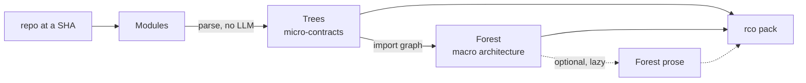
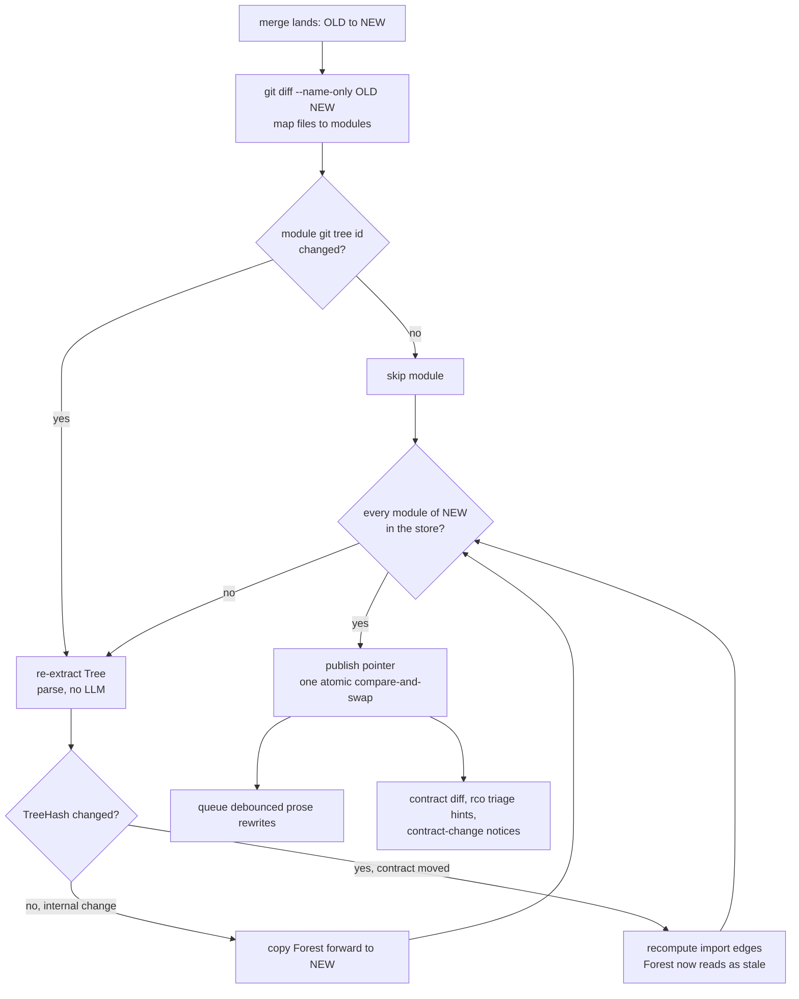
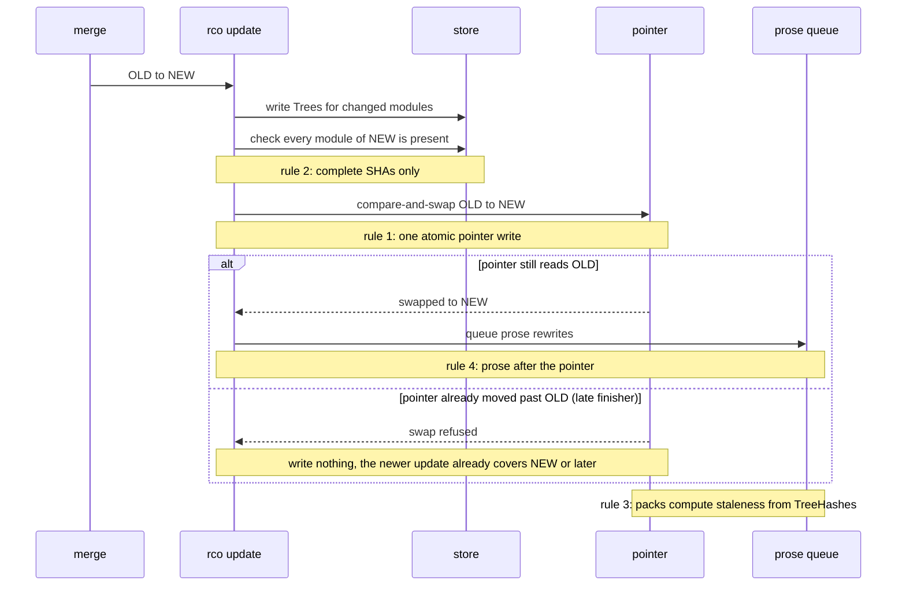
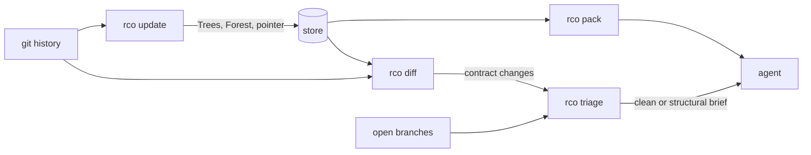
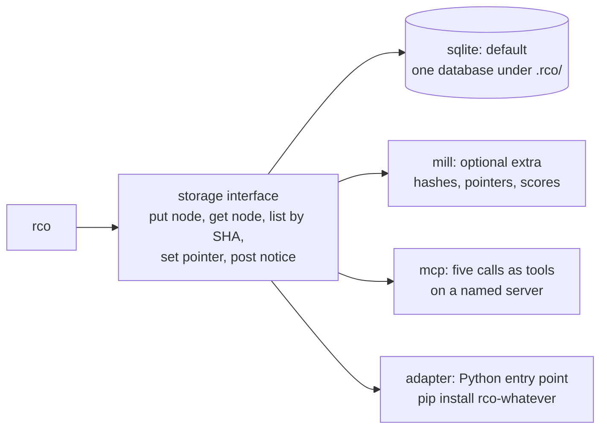
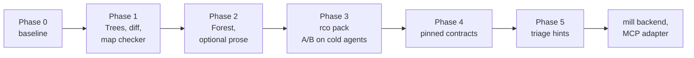
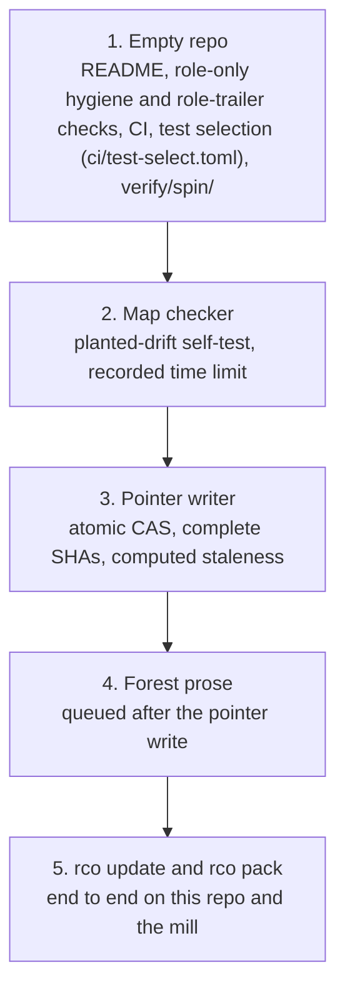
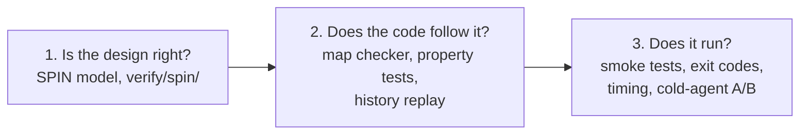

# repo-context-optimizer

Deterministic repo context for coding agents: contract Trees, an architecture Forest, contract diffs, and rebase triage. The goal is to replace LLM tokens with code wherever a contract can be computed.

**Status:**
Phase 0 (baseline) is on `main`. Phase 1 step 1 ships the Tree contract (`docs/design/tree-contract.md`), the Python Tree builder, and the map checker (planted-drift self-test, recorded time limit). Steps 2-6 add the SQL, routes, and CLI extractors, the redaction pass and output contract, and `rco diff`. Later phases remain design.

**Team:** Builder and grok-tui split the development work, Auditor checks the design and models, and Validator passes and merges each PR. A docs desk joins once there is something to document.

### If you are an agent

Run `rco pack --for <files you will touch>`.
Read the pack.
Open raw files only on demand.

## Why

Cold-start agents waste tokens rediscovering a repository: they read too many files, guess at module boundaries, and re-learn contracts that code already knows. Parallel agents on a busy repo pay again in rebase churn, often rereading full diffs when only a contract changed, or waking an agent when no contract they use has moved.

RCO's rule: **if code can compute it, code computes it.** CPU, memory, and disk are cheaper than tokens. LLM use is minimized and optional. `rco` is designed to work with zero tokens.

## Just works

The intended default, once implemented:

```
pip install repo-context-optimizer   # installs the `rco` command
cd any-git-repo
rco pack                   # SHA=HEAD; no --for: whole-repo Forest only; --budget 8000
rco pack --for src/cli.py  # Forest + Trees for those modules and one import hop
rco diff                   # BASE=merge-base(default branch, HEAD); HEAD=HEAD
```

`--budget` is in estimated tokens. The estimator is approximate (characters / 4). The design default is 8000. `--for` is optional. These defaults match the [Planned commands](#planned-commands) section.

Zero config is the goal: the SQLite backend is the default, with no `rco.toml` required. Cache lives in SQLite under `.rco/`, which rco adds to `.git/info/exclude`, never to `.gitignore`. Modules are detected automatically. Parsers for common languages come bundled. An unknown language falls back to a file outline instead of an error. No LLM, keys, or network are required.

`rco.toml`, other backends, adapters, and MCP are all opt-in. If a configured backend fails to load, rco falls back to SQLite and prints the exact command to fix it.

### Acceptance tests (zero-config goal)

| Repo | Expected behavior |
|---|---|
| Small Python repo | Modules detected from the package layout; Trees extracted; `rco pack` and `rco diff` run with the defaults above. |
| Polyglot repo | Bundled parsers used where available; unknown languages fall back to a file outline, not an error. |
| Large monorepo | Pack respects `--budget`; `rco update` re-extracts only modules whose tree ids changed. Cost and hit rate are Phase 0 measurements. |
| Repo with submodules | Submodules are skipped, with a note in the output. |
| LFS repo | LFS pointer files are treated as opaque: not fetched, not parsed as the real blob. |
| Empty repo | Empty pack, exit 0. |

## Concepts



### Module

A module is a logical unit of the repo, not necessarily a directory.

Detection order:

1. Language manifests first (`pyproject.toml`, `package.json`, `Cargo.toml`, `go.mod`, `pom.xml`, and similar).
2. Import-graph clustering (for example Louvain community detection) when packages are not already explicit.
3. Directory fallback for whatever remains, with size caps (for example a maximum file count or line count per module) so summaries stay small enough to be useful.

A checked-in override file can pin boundaries; the detector only falls back to heuristics where that file is silent. A check reports any file that belongs to no module. The override file format is still an open question.

### Tree (micro-contracts)

A Tree is a deterministic contract extracted from a module. It is never written by an LLM.

- **Code contracts:** language-native skeletons with function and method bodies stripped, via Python's `ast` module and tree-sitter for other languages. Public classes and functions, signatures, type hints, the first docstring line, constants, and `__all__` (or the language's equivalent).
- **Non-code contracts,** which often matter more across a repo than signatures alone: CLI commands and flags, SQL schema tables and columns, HTTP routes, and message or event shapes.

Output is canonical (sorted JSON, no line numbers), so identical input always yields byte-identical output. The Tree hash is the sha256 of that JSON.

### Forest (macro architecture)

A Forest describes how modules fit together. Most of it is computed, not generated: layer; depends-on and used-by, from the import graph; entry points; and the commands, tables, and routes a module owns.

A small, optional LLM prose part may add purpose, invariants, and gotchas. rco works with the prose turned off; generation rules live under [Phase 2](#roadmap). A repo-level Forest can render the module graph (for example as a mermaid diagram) plus a short paragraph per layer.

## Fingerprints

Hashes are keyed by content, not by commit.

- **ModuleHash** = the module's own content (git's tree object id for the module's paths, or sha256 of its file hashes) plus the extractor version. **The commit SHA is not part of this key:** including it would invalidate every module on every merge.
- **TreeHash** = sha256 of the canonical Tree JSON.
- **ForestHash** = TreeHash plus prompt version plus model id, so a prompt or model change invalidates only the prose.
- A separate index maps `commit SHA -> module hashes`. A new commit mostly points at existing cache entries. A lookup by tree hash on a miss still resolves identical module states across rebased histories.

Generated summaries are not committed to the default branch. Generated files in the repo would themselves cause rebase conflicts, which is the problem this tool is meant to avoid.

## Incremental update after each merge

The cost of each merge is meant to scale with what the merge changed, not with the size of the repo. Git already says which files moved. How many modules a typical merge touches, and how long a re-extract takes, are Phase 0 measurements.



The same update in order, showing where the four SPIN rules sit:



Staleness is never stored: a pack sees a stale Forest because its TreeHash no longer matches the current Tree's. Several merges in a short window share one prose rewrite per module.

Properties, checked by the SPIN model in `verify/spin/` (see [Verification](#verification)):

- **The pointer write is one atomic compare-and-swap:** move `main` from OLD to NEW only if it still reads OLD and NEW descends from it (for example `git update-ref` with the old value, or a conditional database update). A separate "check, then write" is not enough: two updaters can both pass the check, and a late update then moves the pointer backwards.
- **Publish only a complete SHA:** before the pointer write, check every module of the new SHA against the store, not only the modules in the diff. Otherwise a slow or crashed earlier update leaves a module unbuilt and the pointer moves past it for good.
- **Staleness is computed, not stored:** a pack compares each Forest's TreeHash with the current Tree's. A stored stale flag can be left looking fresh by a race.
- **Queue the prose rewrite after the pointer write,** so a rewrite never describes a Tree that is already out of date and leaves its Forest stale for good.
- Idempotent and content-addressed: running the same update twice equals running it once. There is no hold: mill holds do not auto-expire, so a lock taken for regeneration could be left stuck.
- The new SHA's pointer moves as soon as its Trees are complete. Forest prose catches up asynchronously. A stale Forest is shown as stale, not as if it were current.

Triggers: a git `post-merge` hook, a CI job on push to the default branch, or a merge webhook.

## Planned commands

`rco tree`, `rco check`, and `rco diff` have landed; see [Just works](#just-works). The [output contract](#output-contract) applies to every shipped command. `rco pack`, `rco triage`, and `rco update` are not implemented yet. Defaults match the [quick start](#just-works).

### `rco pack [SHA] [--for FILES] [--budget N]`

- `SHA` defaults to `HEAD`.
- `--for` is optional. If omitted, the pack is the whole-repo Forest only. If present, the pack is the repo Forest, full Trees for the named modules, and Trees one import hop out; anything beyond that is trimmed to its name and one line.
- `--budget N` is in estimated tokens (characters / 4, approximate). Design default: 8000.

The pack is the map; raw files are fetched on demand.

Which command reads and writes what:



#### Pack output (example)

This sample is about 120 estimated tokens (characters / 4; the estimator is approximate).

```markdown
# rco pack  (SHA=abc1234, budget=8000 estimated tokens)

## Forest
- tw: desk CLI and process runner (depends on: proc, client)
- server: HTTP API and schema (used by: tw, wall)
- wall: browser UI

## Trees (full, for --for tw/cli.py)
### tw
def run(argv: list[str]) -> int
def stop_run(run_id: str) -> None
CLI: tw run, tw stop

## One hop (name and one line)
- proc: process supervision for tw runs
- client: shared client library

# budget used: ~120 / 8000 estimated tokens
```

### `rco diff [BASE] [HEAD]`

`BASE` defaults to the merge-base of the repository's default branch and `HEAD`. `HEAD` defaults to `HEAD`.

Lists added, removed, and changed signatures, flags, columns, and routes. For each change it lists callers as `file:line` from a reverse index.

### `rco triage`

Triage never rebases, merges, or pushes anyone's branch. For each open branch it reports either `clean: no changed file, no changed contract used` or a structural brief, as a hint. The branch owner or a merge-main step acts on that hint.

An unchanged contract can still hide a behavior change, so tests still run. The hypothesis, to be measured in Phase 5, is that many branches are contract-clean and need no structural update.

### `rco update`

The incremental post-merge updater described above.

### Structural brief (example)

The brief is generated from the contract diff and the caller index. It is not written by a model.

```markdown
### STRUCTURAL UPDATE REQUIRED
Module `auth_service` in the target branch updated its interface contracts.

#### Contract changes (upstream):
- REMOVED: `validateToken(token: string): boolean`
+ ADDED: `validateToken(token: string, options?: AuthOptions): Promise<AuthResult>`

#### Impacted files in your branch:
- `src/controllers/user_controller.ts` (calls `validateToken`)

#### Task:
Update callers in `src/controllers/user_controller.ts` to match the new `AuthResult` signature.
Do not re-read or modify unaffected modules.
```

## Output contract

Output goes to stdout by default, or to `--out FILE`. `--format markdown` (default) or `--format json`.

Exit codes, so agents can script the commands:

| Code | Meaning |
|---|---|
| 0 | Ok (clean pack, no contract findings, triage all clean). |
| 1 | Findings (contract changed, Forest stale, or triage emitted a structural brief). |
| 2 | Usage error. |
| 3 | Internal error. |

## Secrets

Before any pack output or storage, rco runs a redaction and hygiene pass over extracted constants, docstrings, and other literals. Redacted values are replaced with a placeholder and are never written through. What is redacted:

- Private keys and PEM blocks
- Bearer tokens, API keys, passwords, and other high-entropy secret-shaped strings
- Connection strings and URLs that embed credentials
- Credential-like assignments (for example `password = "..."`, `api_key = "..."`)

Signatures, type names, route paths, flag names, and table or column names are kept. Public identifiers are not treated as secrets.

## Storage backends

Storage sits behind one small interface, chosen in `rco.toml`:

```toml
backend = "sqlite" | "mill" | "mcp" | "<entry point>"
```

The five calls are: put a node, get a node, list nodes by SHA, set a pointer (like a label), and post a notice (a stale Forest or an affected PR). Notices are optional; a backend that can only store still works, and notices go to stdout.



An adapter is a small Python class that implements the five calls and registers through an entry point, so installing it makes it show up with no change to rco. The `mcp` backend maps the same five calls to tools on a server the user names, so any shared-memory tool that exposes MCP works with no Python adapter.

A conformance test suite is the check that an adapter is honest. Every backend runs it against itself.

The SQLite backend (`sqlite`) is the default: one database under `.rco/`. Tree and Forest JSON live in this content store (or another backend's equivalent). They are not copied into mill cards.

The mill backend is an optional extra (`pip install repo-context-optimizer[mill]`) that talks to the mill (si4ai/the-mill). It calls only existing mill commands; it adds no new mill verbs.

- **Content:** Tree and Forest JSON stay in the SQLite content store. The mill holds only hashes and pointers. There is no mill tree node per module per SHA. Mill trees outline mail and todo. Card text has a 4096-character budget.
- **label** holds pointers such as `rco/main` or `rco/0.8.11`. A new label needs `mill create label` (Admin) on limited trust.
- **Staleness** is a score, `stale Forests outstanding`, and optionally one rollup card per repo. Not a card per module. Cards start only when a human asks.
- **mail** may carry a contract-diff notice. Mapping a PR to a desk requires a per-desk GitHub identity, which is not available while desks share one account. Letters are batched, one per affected PR, and addressed; every wake costs tokens.
- **tw** is the mill's recorded command runner. From a desk's sitting `mill connect DESK`, `tw rco update` records the run: start, finished, and failed.
- **score** also tracks LLM tokens rco itself spends (when prose is on) and stale Forests outstanding. Tokens and reads before the first useful action are not produced by rco; see Metrics.

## Metrics

Claim no savings until they are measured against a baseline.

- Tokens and reads before the first useful action, and wrong guesses on cold runs, come from cold-agent logs, not from rco itself. Phase 0 uses the mill's cold-test kit and an existing baseline.
- Branches triage reported clean (hypothesis, measured in Phase 5). Tests still run, because an unchanged contract can hide a behavior change.
- LLM tokens spent per module and per merge, when prose is on (from rco's own logs).
- Stale Forests outstanding (score).

## Roadmap

Development order: a reliable map first, then pins and drift checks, then rebase and merge tools built on the map.



### First slices

Each slice lands before the next starts, and each has a done-when that a check can confirm.



| Slice | Done when |
|---|---|
| 1. Empty repo | CI is green on `main` and selects jobs from [`ci/test-select.toml`](ci/test-select.toml); the hygiene check fails a planted personal name in a test PR; the role-trailer check fails a commit with no known role, so the self-merge check works from the first PR; a desk can take a card from worktree to PR. |
| 2. Map checker | It lists every mismatch (missing, extra, changed) with its path and exits nonzero on any; output is byte-identical for the same inputs; the planted-drift self-test fails if any drift is missed; a time limit is recorded with the RCO SHA. |
| 3. Pointer writer | The SPIN model is committed beside the code and passes all seven properties; a crash between store write and pointer write never publishes a partial SHA. |
| 4. Forest prose | A test shows no prose is ever written for a SHA the pointer has not published. |
| 5. Update and pack | `tw rco update` runs after each merge on this repo and the mill and publishes the merge SHA; `rco pack --for FILES` returns a pack within `--budget`; this is where dogfooding starts. |

Until slice 5 lands, the pipeline ends at merge; from slice 2 on, the map checker reports drift read-only on this repo and the mill.

- **Phase 0.** Baseline, using the mill's cold-test kit and an existing baseline: tokens and reads before the first useful action, plus wrong guesses, from cold-agent logs. Also measure extract cost and how many modules a typical merge touches.
- **Phase 1.** Trees, hashes, and `rco diff` for Python, the CLI, SQL, and routes. Zero LLM. Deterministic tests: same SHA in, same bytes out. Redaction pass and the output contract (stdout/`--out`, format flags, exit codes). The map checker (see [Verification](#verification)) ships with the first Tree builder, so the first map anyone reads comes with a measured accuracy.
- **Phase 2.** The Forest, computed first, with optional prose, plus staleness and name-in-Tree checks. When prose is on, it is generated lazily from the Tree (not raw source), the first time an agent asks for it in a pack; mined first from existing docstrings, module headers, and READMEs, with the model called only when nothing useful exists; written to a fixed template with a hard length cap, using a cheap model; rewritten only when that module's contract hash changes, never on internal edits, and debounced across merges; and checked by code: any name the prose cites must exist in the Tree, or the entry is flagged.
- **Phase 3.** `rco pack`, A/B tested on cold agents.
- **Phase 4.** Pinned contracts: a developer reviews a Tree and commits it as the intended contract; every PR re-extracts and reports drift from the pin as a visible check, not a block. The map then works both ways: it describes the code, and the code is checked against it.
- **Phase 5.** `rco triage` as a hint (never rebases or pushes), plus a cross-PR contract notice in CI (a visible hint, not a block), subject to the identity constraint above. Rebase and merge tools come only after the map is reliable.
- Then the mill backend and the MCP adapter.

Language: Python first, so `pip install repo-context-optimizer` just works. Port only a hot path if measurement shows one. The LLM Forest comes after the deterministic diff and triage, because those are meant to save tokens with zero LLM spend.

Dynamic dispatch (command tables, `getattr`, and similar registries) will need custom extractors, or the CLI Tree will be incomplete. The Forest prose will drift unless the staleness signal is actually read.

## Verification

Three layers, the same ones the mill uses for its own protocol.



1. **Is the design right?** A SPIN (or TLA+) model of `rco update` with racing merges, a late update, a crash midway, and a rebased history. Properties: the pointer only moves forward (a new SHA must descend from the current one, checked and written in one atomic compare-and-swap); a published pointer always has its Trees; a stale Forest is never shown as current; an update run twice equals one run; no changed module is skipped; every Forest eventually becomes fresh. Status: modelled in `verify/spin/rco_update.pml` (linear history, two modules, two updaters, one crash, one duplicate). The design as first written failed all seven properties; with the four rules above it passes all seven. Rebased history and a lossy store are not modelled yet.
2. **Does the code follow the design, and is the map true?** The map checker takes a repo, a SHA, and a map, and reports each claim as true, false, or missing, with no LLM:
   - Contracts: every function, flag, table, column, and route in a Tree exists at that SHA with that shape, checked by a fresh parse and by real outputs (`--help`, the live schema, the route table). It also reports what the Tree missed.
   - Edges: every depends-on and used-by link matches the import graph at that SHA.
   - Freshness: the map's SHA and module hashes match the code.
   - Prose names: every name the Forest prose cites exists in the Tree.
   - The checker checks itself: maps with planted errors (a removed flag, a renamed column, a missing edge) must all be flagged.
   Alongside it: property tests (Hypothesis) that mirror the model's properties over random edit and merge sequences; a history replay where incremental updates must equal a full rebuild at every SHA of the default branch; and golden fixture repos with known Trees and Forests.
3. **Does it run?** The zero-config acceptance table as smoke tests, the exit-code contract, timing and budget on the replay, and the cold-agent A/B, which is the only evidence that the map helps.

When `--budget` trims a pack, the pack names what it trimmed.

## Open questions

- **PyPI package name.** Publish as `repo-context-optimizer` (installs the `rco` command). It was unclaimed on PyPI on 2026-11-09; the first release claims it.
- **Which prose pieces truly need an LLM.** Find out empirically: ship Phase 1 with no LLM, then see what cold agents still ask for or get wrong.
- **Module override file format.**
- **Default `--budget`.** 8000 estimated tokens is the design default; confirm against Phase 0 pack sizes.

## Proposed: merge planning (mill tool, scope TBD)

**Status:** a proposal. The human and the desks will discuss scope before any work starts.

**Where it lives:** in the mill, as a host report plus a desk CLI command. The optimizer later feeds it a file- and function-level map in place of the plain diffs.

**What it does:**

- For open PRs, or a card's planned file list, it reports which ones collide on the same files or lines.
- It groups the rest into lanes that can land in any order.
- It suggests a merge order and names which PR needs a rebase after each merge.
- It previews collisions before code is written.

**Design:** deterministic, with no LLM. Data gathering is kept separate from the conflict graph so the optimizer's map can plug in later. It is a visible check or hint, never a hard block.

**Quick win:** generate the CHANGELOG at release time, so PRs stop conflicting on it.

**Possible split:** Builder takes the server report and the graph; grok-tui takes the CLI. The two agree on the JSON shape first.

**Open questions for the scope discussion:** line-level or function-level granularity; whether it is advisory only or wired into Validator; the CHANGELOG format.

## Prior art

AST skeletonizers, ctags, tree-sitter, Aider's repo map, and various repo packers already extract structure or pack context. RCO's difference is content-addressed incremental Trees and Forest, a contract diff, rebase triage that reports a hint rather than touching branches, and pluggable storage.

## Process and GitHub setup

This repository dogfoods a portable process: checks over rules, report-only CI reports that show facts, and an independent Validator that passes and merges. A hidden-code report (`tools/check_hidden_code.py`) runs on every PR and push. It exits 0 on findings; a crash fails the job. The recipe for pointing the same process at a user repository is in [`docs/github-setup.md`](docs/github-setup.md).

## License

MIT. See [LICENSE](LICENSE).
