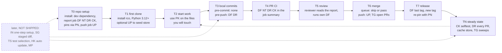
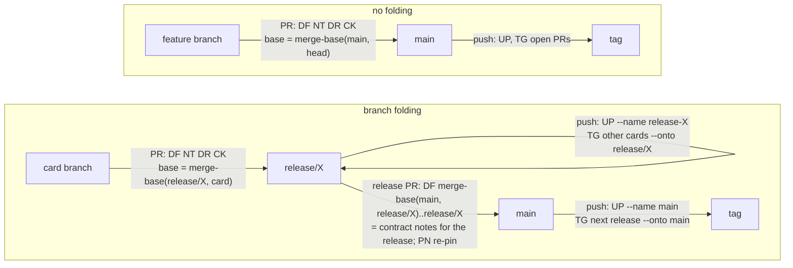
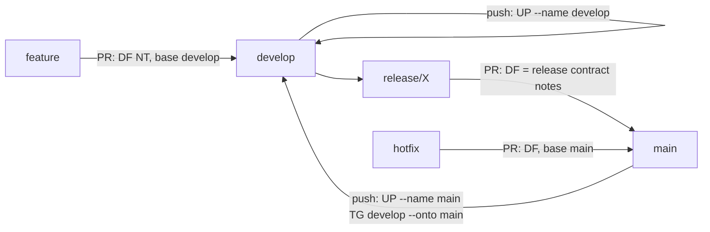
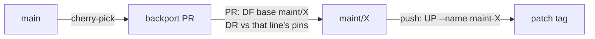
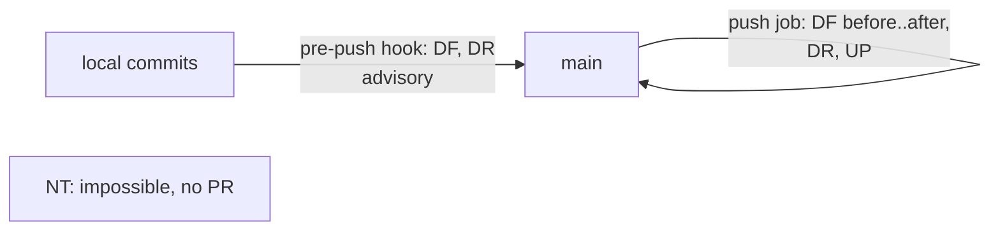
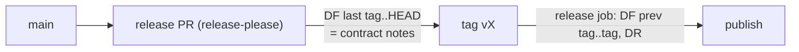

# adopting rco from T0 to TN

Status: draft for review. Written against rco 0.1.1 (main at `f9c415f`). Every claim below was checked by running the 0.1.1 CLI on this repo, on two other repos, and on small fixture repos. PyPI still has only 0.1.0 when this was written, so `pip install repo-context-optimizer` does not give you 0.1.1 yet.

This guide answers three questions for any repository: what to set up, where it goes, and why. It covers each stage of a repo's life, from setup (T0) to steady state (TN), for each repo type and each release approach.

## bottom line

- rco is a report tool. Every place it goes in a pipeline is advisory: a job that shows facts and never blocks a merge. Exit 1 means "findings", not "failure".
- What works today: a PR job that runs `rco diff`, `rco notice`, `rco drift` and `rco check`. On top of that, `rco update` and `rco triage` after a merge, and `rco pack` for any agent at any time.
- What does not work today: commit-time hooks (rco reads commits, not staged files), non-Python contracts (except SQL), one-step setup, and test selection.
- Always pass an explicit base and head in CI, and check out full history. The default base looks for `origin/HEAD`, `main` or `master`, and a CI checkout often has none of them.

## How to choose

Answer three questions, then read your rows off the tables below.

1. Repo type: Python, polyglot, monorepo, has submodules, uses LFS, or empty? See [repo types](#repo-types).
2. Release approach: how do changes reach a release? trunk (PRs straight to main), branch folding (release branches), Git flow, maintenance lines, tag-driven? See [Release approaches](#release-approaches).
3. Merge option: squash, merge commit, rebase, merge queue, or direct pushes? This sets which commits rco compares after a merge.

Then start from the [stage table](#stages-t0-to-tn) and apply the "what differs" notes for your type and approach.

### worked examples (settings read from GitHub and the workflow files)

| repo | Type | Release approach | Merge option | protection | what to add |
|---|---|---|---|---|---|
| repo-context-optimizer | small Python | branch folding: card PRs into `release/X`, then a release PR into main (squashed) | squash or merge; queue with merge method MERGE | ruleset on main; required: pytest, spin, hidden_code_report | already has `drift_report` and `notice_report`. Add a diff job, a map check job, and a push trigger on `release/**` for update and triage |
| the-mill | large Python (885 .py) | branch folding: card PRs into `release/X.Y.Z`, release branch lands on main with a merge commit | squash or merge; queue with merge method MERGE | ruleset on main; required: build_pack, check_pack, mill_cli_smoke, pytest_* | install rco (hash-locked), add one report job off the required list, add a push trigger on `release/**` |
| md2xarticle | small Python | trunk: PRs squashed to main, plus some direct pushes | squash, merge and rebase all allowed; no queue | no rulesets | PR report job, a push-to-main report job (covers direct pushes), an optional pre-push hook, and a Python 3.12 job |

## capability legend

Codes are used in every table and diagram. Shipped = in the 0.1.1 CLI (`src/rco/cli.py`). NOT SHIPPED = planned in the README or design docs, or a gap found in this review.

### shipped in 0.1.1

| Code | Command | what it answers | Exit codes |
|---|---|---|---|
| TR | `rco tree [SHA]` | what are the public contracts (functions, classes, argparse flags, SQL tables, routes) at this commit? | 0 |
| FO | `rco forest [SHA]` | How do modules depend on each other, and what are the entry points? | 0 |
| PK | `rco pack --for FILES` | what do I need to know before I edit these files? Forest plus Trees for those modules and one import hop, within `--budget` tokens | 0; 2 if budget < 64 |
| DF | `rco diff BASE HEAD` | Which contracts changed between two commits, and who calls them? | 0 none, 1 changes |
| CK | `rco check MAP` / `--selftest` | Is this map still true for the code? Does the checker catch planted errors? | 0 ok, 1 findings |
| UP | `rco update [SHA] --name P` | save a commit's map to the local store `.rco/rco.db` and move pointer P forward | 0; refuses to move backwards |
| PN | `rco pin --for FILES` | freeze a reviewed contract as `pins/NAME.json` | 0 |
| DR | `rco drift pins` | did any pinned contract change? | 0 none, 1 drift |
| TG | `rco triage BRANCH... --onto T` | does my branch use anything the target changed? | 0 clean, 1 brief |
| NT | `rco notice OTHER... --base B --head H` | Which other open branches use what this PR changed? | always 0 |

Exit 2 = usage error, exit 3 = internal error, for every command. A CI job should pass on 0 and 1 and fail on 2 and 3.

### NOT SHIPPED

| Code | Item | source |
|---|---|---|
| CF | `rco.toml` config and backend choice | README "storage backends"; no code reads `rco.toml` |
| LG | parsers for non-Python languages (tree-sitter) | README "Tree"; only `.py` and `.sql` extractors exist |
| LP | LLM prose | hook exists in `src/rco/prose/llm.py`, off, no config path |
| MB | mill backend extra | README "storage backends"; no extra in `pyproject.toml` |
| MC | MCP backend / adapter | README roadmap |
| MO | module override file, manifest-based module detection | README "Module"; modules are directories today |
| HK | post-merge hook or webhook trigger for update | README "triggers" |
| TW | `tw rco update` recorded runs | README slice 5 |
| NM | notices sent by mail through a backend | README "storage backends" |
| RO | check against real outputs (`--help`, live schema, routes) | `docs/design/tree-contract.md` |
| MP | merge planning | README "proposed: merge planning" |
| IN | `rco init` or a reusable GitHub action (gap) | not designed |
| SG | diff of staged or working-tree changes (gap) | not designed; rco reads git objects only |
| TS | test selection from a diff (gap) | not designed; README says tests still run |
| SS | a shared or cached store for CI (gap) | not designed; the store is local SQLite |

## stages T0 to TN



| stage | what to do | Where | Required? | Why | works today? |
|---|---|---|---|---|---|
| T0 setup | add `repo-context-optimizer` as a dev dependency; add one report job (DF, NT, DR, CK); pin key contracts with PN; add a push job that runs UP | `pyproject.toml` or CI lock file; `.github/workflows/ci.yml`; `pins/*.json` | advisory; keep rco jobs out of required checks | the job shows contract facts on every PR without blocking anyone | yes, by hand (IN not shipped) |
| T1 first clone | `pip install`; optionally `rco update` once | contributing doc | advisory | the store adds mined prose to packs; packs work without it | yes; needs Python 3.12+ |
| T2 start work | `rco pack --for <files>` | contributing doc, agent instructions | advisory | the agent starts from the contracts, not by reading whole modules | yes |
| T3 local commits | nothing at pre-commit; at pre-push, `rco diff $(git merge-base origin/<base> HEAD) HEAD` and `rco drift pins` | `.githooks/pre-push` | advisory, always exit 0 | catches contract changes before they leave the machine | pre-push yes; pre-commit no (SG) |
| T4 PR CI | DF with base = merge-base of PR base and head; NT against other open PR heads; DR if `pins/` exists; CK | `ci.yml` on `pull_request`, `fetch-depth: 0`, `pull-requests: read` for NT | advisory | reviewers see changed contracts and cross-PR overlap | yes |
| T5 review | read the report; run your own DF; still read the code | reviewer checklist | advisory | DF lists public contract changes, not every behavior change | yes |
| T6 merge | merge_group: skip rco jobs (or run them, if you made them required); after merge: UP `--name <branch>` and TG other open PRs `--onto <branch>` | `ci.yml` on `push` to each target branch | advisory | the map follows the branch; open PRs learn what moved under them | yes; store is gone after the job unless cached (SS) |
| T7 release | DF from the last release tag to the new one as contract notes; DR clean, or re-pin on purpose | release workflow or release checklist | advisory | release notes for contracts at zero tokens | yes |
| TN steady | CK `--selftest` and a map check on a schedule; DR on every PR; refresh pins; TG sweeps | `ci.yml` (schedule), `actions/cache` for `.rco/` | advisory | keeps the map honest and current | yes; HK, TS, MP not shipped |

### A report job you can copy (T4 and T6)

simulated locally with pull_request and push events, including an all-zero `before`. It has not been run in GitHub Actions yet. Pin the actions to full SHAs.

```yaml
  rco_report:
    if: github.event_name != 'merge_group'
    runs-on: ubuntu-latest
    timeout-minutes: 10
    permissions:
      contents: read
    steps:
      - uses: actions/checkout@<sha> # v4
        with:
          fetch-depth: 0
          persist-credentials: false
      - uses: actions/setup-python@<sha> # v5
        with:
          python-version: "3.12"
      - run: pip install repo-context-optimizer==0.1.1
      - env:
          EVENT_NAME: ${{ github.event_name }}
          PR_BASE: ${{ github.event.pull_request.base.sha }}
          PR_HEAD: ${{ github.event.pull_request.head.sha }}
          PUSH_BEFORE: ${{ github.event.before }}
          PUSH_SHA: ${{ github.sha }}
        run: |
          set -uo pipefail
          if [ "$EVENT_NAME" = pull_request ]; then
            head="$PR_HEAD"; base=$(git merge-base "$PR_BASE" "$PR_HEAD")
          else
            head="$PUSH_SHA"; base="$PUSH_BEFORE"
          fi
          if ! git cat-file -e "${base:-missing}^{commit}" 2>/dev/null; then
            base=$(git rev-parse --verify --quiet "$head^1" || true)
          fi
          [ -n "$base" ] || { echo "no base: no rco report"; exit 0; }
          rco diff "$base" "$head" > rco.md; code=$?
          if [ -d pins ]; then rco drift pins --at "$head" >> rco.md; d=$?; [ "$d" -le 1 ] || code=$d; fi
          cat rco.md >> "$GITHUB_STEP_SUMMARY"
          case "$code" in 0|1) exit 0 ;; *) exit "$code" ;; esac
```

For `rco notice`, use the pattern in this repo's `ci/notice_report.sh` and `ci/notice_heads.py`. They are not in the wheel, so copy them. See [known issues](#known-issues-found-in-this-review) before you copy.

## repo types

The README's zero-config acceptance table, checked against 0.1.1 with fixture repos.

| Type | README expects | what 0.1.1 does | verdict | How the pipeline differs |
|---|---|---|---|---|
| Small Python | modules from package layout; Trees; pack and diff with defaults | Trees, argparse flags and callers extracted; a signature change shows in DF with its caller. Modules are directories, not read from manifests | verified, with the module caveat | none: use the stage table as is |
| polyglot | bundled parsers where available; unknown languages fall back to an outline, no error | only Python and SQL are parsed; `.js`, `.ts`, `.go`, `.rs` become file outlines. A JS signature change gives "no contract changes". A SQL column add is caught | outline holds; non-Python parsers NOT SHIPPED (LG) | DF, NT and DR only cover the Python and SQL parts. For other languages, NT reports files changed on both sides. Do not read "no contract changes" as "safe" |
| Large monorepo | pack respects `--budget`; update re-extracts only changed modules | 60-package fixture: first update extracted 60 modules, the next extracted 2. `--budget 500` used 499 and listed what it trimmed. On a real 885-file repo, each command took 2-5 s | verified at that size; cost at larger scale not measured | use `--for` on every pack; cache `.rco/` in CI. Per-package releases are not modeled (MO not shipped) |
| submodules | skipped, with a note | `tree` prints "note: skipped submodule ..."; `pack` and `diff` print no note; adding a submodule shows "no contract changes" | partly: the note only appears in `tree` | contracts inside submodules are invisible; run rco in the submodule's own repo |
| LFS | pointer files opaque, not fetched | a pointer shows as `file ... (lfs=pointer)` | verified (pointer committed without git-lfs) | none; no need for `lfs: true` on checkout |
| Empty | empty pack, exit 0 | repo with no commits: every command exits 2 "not a commit: HEAD". Repo with an empty commit: empty pack, exit 0 | differs for a repo with no commits | at T0, make the first commit before adding rco jobs, or guard the job on `git rev-parse HEAD` |

## Release approaches

Every approach uses the same rule for pull requests: base = `git merge-base <PR base sha> <PR head sha>`, head = PR head. What changes is which branches get a push job, and what UP and TG point at.

| Approach | examples | PR run | After merge (push) | Merge queue | Main caveat |
|---|---|---|---|---|---|
| trunk + squash (GitHub flow) | md2xarticle; card PRs into main | DF NT DR CK | DF before..after (one squash commit), UP `--name main`, TG open PRs `--onto main` | n/a | per-commit history is gone; fine for rco, which compares trees |
| trunk + merge commits | - | same | same; before..after spans the merge | n/a | none for rco |
| trunk + rebase merge | allowed in md2xarticle | same | same; before..after spans the rebased commits | n/a | PR-time SHAs never reach main; cite main SHAs in notes and pins |
| Merge queue (any method) | the-mill, repo-context-optimizer | same | push after the queue lands | merge_group: base_sha..head_sha. Skip rco jobs there, or run them if required | a required job that skips blocks the queue |
| Branch folding (release branches) | the-mill, repo-context-optimizer | card PR into `release/X`: base = merge-base with `release/X`. Release PR into main: DF = whole release | push to `release/X`: UP `--name release-X`, TG card PRs `--onto release/X`. Push to main: UP `--name main` | as above | default base is main; always pass the release branch base explicitly |
| Git flow | - | feature PRs into `develop`; release and hotfix PRs into main | UP per branch (`develop`, `main`); after a hotfix, TG `develop --onto main` | as above | same base caveat as folding |
| maintenance lines with backports | - | backport PR into `maint/X`: base = merge-base with `maint/X` | UP `--name maint-X`; DR against pins at that line's tag | as above | each line keeps its own `pins/` |
| stacked PRs | - | base = the parent PR branch; DF shows only this layer | rerun when the parent lands and GitHub retargets | as above | NT sees the stack as overlapping |
| forks | any public repo | `pull_request` from a fork: read-only token; DF and NT still work | as trunk | as above | never use `pull_request_target` to check out fork code |
| direct pushes, no protection | md2xarticle (some commits) | none: no PR, so no NT | push job: DF before..after, DR, UP; pre-push hook is the early warning | n/a | a force push makes `before` a non-ancestor; UP refuses it, as designed |
| Tag-driven releases (semantic-release, release-please) | - | release PR: DF last tag..HEAD as contract notes | on tag: DF previous tag..tag | as above | rco does not suggest a version bump; a human decides |

### Branch folding vs no folding



### Git flow



### maintenance lines with backports



### direct pushes, no protection



### Tag-driven releases



## Agents on demand: the map without LLM tokens

Outside any pipeline, an agent can ask rco at any time. answers are computed from git objects with no model, no keys and no network. The LLM prose path is off; prose is mined from docstrings and READMEs.

| question the agent has | Command |
|---|---|
| what are the public contracts of this module? | `rco tree --for <path>` |
| How is the repo put together, and what depends on what? | `rco forest` |
| what do I need before editing these files? | `rco pack --for <files> --budget 8000` |
| what did this branch change in contracts, and who calls them? | `rco diff <merge-base> HEAD` |
| Is the map I was handed still true? | `rco check <map.json>` |
| Will my branch break against the target? | `rco triage <branch> --onto <target>` |

Sizes measured on two repos (tokens = characters / 4, the estimate rco uses):

| repo | All .py read raw | `rco tree` (full map) | `rco forest` | `rco pack --for` one file | raw files in that file's module |
|---|---|---|---|---|---|
| repo-context-optimizer (101 .py) | 127,115 | 13,603 | 760 | 4,062 | 26,898 (21 files) |
| the-mill (885 .py) | 1,519,485 | 138,279 | 3,269 | 5,292 | 21,238 (11 files) |

These are size ratios, not savings. No A/B savings claim exists yet. The harness is in `tools/phase3_ab.py`, but the counting run waits for a released install. The README says to claim no savings until they are measured against a baseline.

## known issues found in this review

- `ci/notice_report.sh` passes the PR base tip as `--base`, not the merge-base. `rco diff` uses an explicit base as given, so a PR whose base branch moved on shows the base's new changes reversed. Fix: pass `git merge-base`.
- `ci/notice_heads.py` lists every open PR, whatever its base branch. With branch folding, filter to PRs into the same base.
- Caller lists match bare names, so a common name such as `label` lists callers that are not related.
- After `rco update`, `rco check` adds prose-name findings: 38 on the-mill, 2 on md2xarticle. A map check job should run before update, or treat these as advisory.
- `rco diff` with no arguments fails in a detached CI checkout that has no `main`, and `HEAD~1` fails in a shallow clone. Use `fetch-depth: 0` and explicit SHAs.
- The package needs Python 3.12+. Repos that test on 3.10 or 3.11 need a separate 3.12 job for rco.
- A repo with no commits exits 2, where the README table says exit 0.

## appendix: internal dogfood (optional)

proposals only. Nothing is built.
- repo-context-optimizer: fix the two notice issues above; add diff and map check jobs; add a push trigger on `release/**` for UP and TG. Owner: Builder; Validator measures.
- the-mill: publish 0.1.1 and add a hash-locked install; add one report job, kept off the required list; add a push trigger on `release/**`; add `rco pack` to the contributing doc and the builder skill, and the report to the validator skill. Owners: Builder, Gardener, Validator.
- md2xarticle: PR and push-to-main report jobs on Python 3.12, plus an optional pre-push hook. Owners: Builder, the md2xarticle desk.
