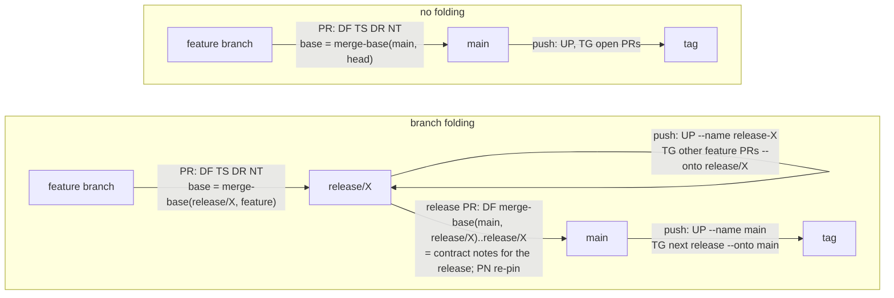
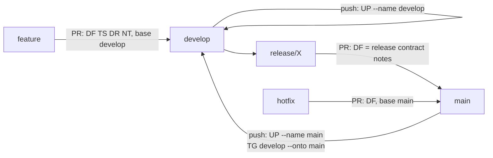
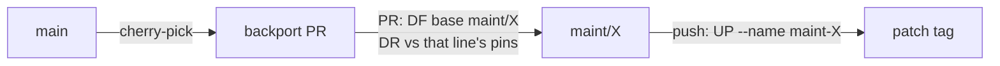
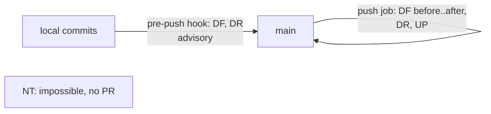
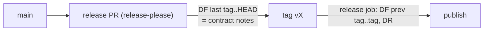

# adopting rco from T0 to TN

Written against rco 0.1.6. Commands, flags and files named here are in the 0.1.6 wheel. If you install a different version, check its CHANGELOG first.

This guide answers three questions for any repository: what to set up, where it goes, and why. It covers each stage of a repo's life, from setup (T0) to steady state (TN), for each repo type and each release approach. For the repository around rco (settings, rulesets, pinned Actions, reports), see [GitHub setup](../github-setup.md).

## bottom line

- rco is a report tool. Every place it goes in a pipeline is advisory: a job that shows facts and never blocks a merge. Exit 1 means "findings", not "failure". Exit 2 (usage error) and 3 (internal error) fail the job.
- Setup is one command: `pip install repo-context-optimizer==0.1.6`, then `rco init` at the top of your checkout. It writes `rco.toml` and `.github/workflows/rco.yml`. On a pull request that workflow puts `rco diff`, `rco affected`, `rco drift` (when `pins/` exists) and the cross-PR notice into the job summary. On a push to the default branch it runs `rco update`. rco itself needs nothing copied from the rco repository; the Files to copy list in github-setup.md is optional CI hardening.
- Not in the `rco init` workflow: `rco check`, `rco triage` and `rco plan`. Add them by hand if you want them (see the stage table).
- What does not work today: LLM prose (off by design), the mill and MCP backends, notices sent by mail, and recorded `tw rco update` runs.
- Always pass an explicit base and head in CI, and check out full history. The default base looks for `origin/HEAD`, `main` or `master`, and a CI checkout often has none of them. The `rco init` workflow already does both.

## How to choose

Answer three questions, then read your rows off the tables below.

1. Repo type: Python, polyglot, monorepo, has submodules, uses LFS, or empty? See [repo types](#repo-types).
2. Release approach: how do changes reach a release? trunk (PRs straight to main), branch folding (release branches), Git flow, maintenance lines, tag-driven? See [Release approaches](#release-approaches).
3. Merge option: squash, merge commit, rebase, merge queue, or direct pushes? This sets which commits rco compares after a merge.

Then start from the [stage table](#stages-t0-to-tn) and apply the "what differs" notes for your type and approach.

## setup (T0): `rco init`

Check first: rco needs Python 3.12 or newer. The workflow it writes runs on GitHub Actions.

```
pip install repo-context-optimizer==0.1.6
cd your-repo
rco init            # add --hooks for the post-merge hook
```

`rco init` writes only files that are not there yet, and reports each one as wrote or kept:

- `rco.toml`: every setting commented out, so the defaults apply until you edit a line.
- `.github/workflows/rco.yml`: one job, `ubuntu-latest`, Python 3.12, actions pinned to full SHAs, `fetch-depth: 0`, and `permissions: contents: read, pull-requests: read`. It installs `repo-context-optimizer==` the version that wrote it.
  - On `pull_request`: base = `git merge-base` of the PR base and head. It runs `rco diff`, `rco affected`, `rco drift pins` (when `pins/` exists), then `python -m rco.notice_report`, the cross-PR notice that ships in the wheel. The notice lists the other open PRs into the same base branch with `gh api`, fetches each head as `pr-N`, and runs `rco notice`. The step fails only if one of them exits 2 or 3.
  - On `push` to the default branch: `rco update --name <branch>`, with `.rco/` kept in `actions/cache`.
- With `--hooks`: a `post-merge` hook that runs `rco update --name <branch>` in the background and always exits 0. `--remove-hooks` deletes it only if rco wrote it.

Then commit the two files, open a PR, and read the job summary. It is on the workflow run page, not in the check-run API. Keep the `rco` job out of your required checks.

Limits of the generated workflow:

- It has no `merge_group` trigger, so a merge queue does not run it. That is right while it is advisory.
- The notice needs the `gh` CLI (present on GitHub-hosted runners) and `GH_TOKEN`, which the workflow sets to `github.token`.
- The checkout drops its token (`persist-credentials: false`). On a private repository, fetching another PR's head then fails and the notice exits 3. Either let the checkout keep its token or delete the notice lines from the step.
- If your repo already has a CI workflow and you want rco inside it, copy the `rco` job from the generated `rco.yml` instead of keeping two files.

## The local store

`rco update` writes a SQLite store at `.rco/rco.db` (the default; `rco.toml` can move it). It is per checkout and rebuilt from git, so nothing is shared or synced between people or agents. First use adds `.rco/` to `.git/info/exclude`, never to `.gitignore`. The store runs in WAL mode, which needs every process on one machine: never put it on a network share or on a host that several users share. Cross-checkout views come from GitHub instead: the CI cache of `.rco/` and the notice, which reads open PR heads. A shared store would be a backend adapter, which is designed but not shipped.

## capability legend

Codes are used in every table and diagram. Shipped = in the 0.1.6 CLI or wheel. NOT SHIPPED = planned in the README or design docs.

### shipped in 0.1.6

| Code | Command | what it answers | Exit codes |
|---|---|---|---|
| TR | `rco tree [SHA]` | what are the public contracts (functions, classes, argparse flags, SQL tables, routes, and the bundled languages) at this commit? | 0 |
| FO | `rco forest [SHA]` | How do modules depend on each other, and what are the entry points? | 0 |
| PK | `rco pack --for FILES` | what do I need to know before I edit these files? Forest plus Trees for those modules and one import hop, within `--budget` tokens | 0; 1 if stored prose is stale; 2 if budget is too small (< 64, or below the header and footer) |
| DF | `rco diff BASE HEAD` | Which contracts changed between two commits, and who calls them (qualified, not by bare name)? | 0 none, 1 changes |
| CK | `rco check MAP` / `--selftest` | Is this map still true for the code? Does the checker catch planted errors? | 0 ok, 1 findings |
| UP | `rco update [SHA] --name P` | save a commit's map to the store and move pointer P forward | 0; refuses to move backwards |
| PN | `rco pin --for FILES --format json --out pins/NAME.json` | freeze a reviewed contract as a pin file (without `--out`, it prints markdown) | 0 |
| DR | `rco drift pins` | did any pinned contract change? | 0 none, 1 drift |
| TG | `rco triage BRANCH... --onto T` | does my branch use anything the target changed? | 0 clean, 1 brief |
| NT | `rco notice OTHER... --base B --head H`; in CI, `python -m rco.notice_report` | Which other open branches use what this PR changed? | always 0; the CI module exits 3 if it cannot list or fetch the other PRs |
| MP | `rco plan BRANCH BRANCH... [--base B]` | what does each branch change that another uses, which tests see both, and in what order should they merge? | 0 clean, 1 findings |
| TS | `rco affected [BASE] [HEAD]` | which tests can see this change? | 0 |
| SG | `rco diff --staged` / `--worktree` | which contracts does my uncommitted change touch? | 0 none, 1 changes |
| IN | `rco init [--hooks]` | set up `rco.toml`, a CI workflow (DF, TS, DR, NT on PRs; UP on push) and hooks in one step | 0 |
| HK | post-merge hook from `rco init --hooks` | keep the store current after each merge | 0 |
| RO | `rco live [SHA] --schema/--openapi/--help-text` | does the map match a real schema dump, OpenAPI file or `--help` output? | 0 ok, 1 findings |
| LG | bundled parsers | JavaScript/TypeScript, Go, Rust, shell and PowerShell contracts | n/a |
| MO | modules from `rco.toml`, then `package.json` / `Cargo.toml`, then directories | n/a | n/a |
| CF | `rco.toml` settings and backend choice (`sqlite` or an entry point adapter) | n/a | n/a |
| SS | a store cached across CI runs | n/a | n/a |

Exit 2 = usage error, exit 3 = internal error, for every command. A CI job should pass on 0 and 1 and fail on 2 and 3.

### NOT SHIPPED

| Code | Item | source |
|---|---|---|
| LP | LLM prose | hook exists, off by design |
| MB | mill backend extra | README "storage backends"; design only |
| MC | MCP backend / adapter | README roadmap |
| TW | `tw rco update` recorded runs | README slice 5 |
| NM | notices sent by mail through a backend | README "storage backends" |

A merge webhook still needs your own server. Merge planning beyond `rco plan` (planned file lists, lanes) is still a README proposal.

## stages T0 to TN

```mermaid
flowchart LR
  T0["T0 repo setup<br/>IN: rco.toml and rco.yml<br/>(DF TS DR NT, push UP),<br/>pins via PN"]
  T1["T1 first clone<br/>install rco, Python 3.12+<br/>optional UP to seed store"]
  T2["T2 start work<br/>use PK on the files<br/>you will touch"]
  T3["T3 local commits<br/>pre-commit: none<br/>pre-push: DF DR"]
  T4["T4 PR CI<br/>DF TS DR NT in the<br/>job summary"]
  T5["T5 review<br/>reviewer reads the report,<br/>runs own DF"]
  T6["T6 merge<br/>queue: skip or pass<br/>push: UP, TG open PRs"]
  T7["T7 release<br/>DF last tag..new tag<br/>re-pin with PN"]
  TN["TN steady state<br/>CK selftest, DR every PR,<br/>cache store, TG sweeps"]
  T0 --> T1 --> T2 --> T3 --> T4 --> T5 --> T6 --> T7 --> TN
  TN -.-> T2
```



| stage | what to do | Where | Required? | Why | in the `rco init` workflow? |
|---|---|---|---|---|---|
| T0 setup | install rco; run `rco init` (IN); commit `rco.toml` and the workflow; pin key contracts with PN. Pin the files most others import, one pin file per area. | `rco.toml`, `.github/workflows/rco.yml`, `pins/*.json`; repo settings per [GitHub setup](../github-setup.md) | advisory; keep rco jobs out of required checks | the job shows contract facts on every PR without blocking anyone | yes, except PN: pins are your choice |
| T1 first clone | `pip install`; optionally `rco update` once | contributing doc | advisory | the store adds mined prose to packs; packs work without it | n/a; needs Python 3.12+ |
| T2 start work | `rco pack --for <files>` | contributing doc, agent instructions | advisory | the agent starts from the contracts, not by reading whole modules | n/a |
| T3 local commits | nothing at pre-commit; at pre-push, `rco diff $(git merge-base origin/<base> HEAD) HEAD` and `rco drift pins` | `.githooks/pre-push` | advisory, always exit 0 | catches contract changes before they leave the machine | no; you write the hook. `rco diff --staged` (SG) works at commit time |
| T4 PR CI | DF with base = merge-base of PR base and head; TS; DR if `pins/` exists; NT against other open PR heads; optionally CK on a map you keep | `rco.yml` on `pull_request`, `fetch-depth: 0`, `pull-requests: read` for NT | advisory | reviewers see changed contracts and cross-PR overlap | yes for DF, TS, DR, NT; add CK by hand |
| T5 review | read the report; run your own DF; still read the code | reviewer checklist | advisory | DF lists public contract changes, not every behavior change | n/a |
| T6 merge | merge_group: skip rco jobs (or run them, if you made them required); after merge: UP `--name <branch>` and TG other open PRs `--onto <branch>` | `rco.yml` on `push` to each target branch | advisory | the map follows the branch; open PRs learn what moved under them | UP on the default branch, with the store cached (SS); add TG and other branches by hand |
| T7 release | DF from the last release tag to the new one as contract notes; DR clean, or re-pin on purpose | release workflow or release checklist | advisory | release notes for contracts at zero tokens | no; add by hand |
| TN steady | CK `--selftest` and a map check on a schedule; DR on every PR; refresh pins; TG sweeps | a scheduled workflow, `actions/cache` for `.rco/` | advisory | keeps the map honest and current | DR and the cache yes; the rest by hand |

## repo types

| Type | what rco does | How the pipeline differs |
|---|---|---|
| Small Python | modules from the package layout; Trees with functions, classes, argparse flags and callers | none: use the stage table as is |
| polyglot | bundled parsers (LG) for Python, SQL, JS/TS, Go, Rust, shell and PowerShell; other languages become file outlines, with no error | DF, NT and DR only see contracts in the parsed languages. For other languages, NT reports files changed on both sides. Do not read "no contract changes" as "safe" there |
| Large monorepo | pack respects `--budget`; update re-extracts only changed modules; modules come from `rco.toml`, then `package.json` / `Cargo.toml`, then directories (MO) | use `--for` on every pack; cache `.rco/` in CI. Per-package releases are not modeled |
| submodules | skipped | contracts inside submodules are invisible; run rco in the submodule's own repo |
| LFS | pointer files are opaque and not fetched | none; no need for `lfs: true` on checkout |
| Empty | a repo with no commits gives an empty pack, tree and forest, exit 0 | make the first commit before the PR job means anything |

## Release approaches

Every approach uses the same rule for pull requests: base = `git merge-base <PR base sha> <PR head sha>`, head = PR head. What changes is which branches get a push job, and what UP and TG point at.

| Approach | PR run | After merge (push) | Merge queue | Main caveat |
|---|---|---|---|---|
| trunk + squash (GitHub flow) | DF TS DR NT | DF before..after (one squash commit), UP `--name main`, TG open PRs `--onto main` | n/a | per-commit history is gone; fine for rco, which compares trees |
| trunk + merge commits | same | same; before..after spans the merge | n/a | none for rco |
| trunk + rebase merge | same | same; before..after spans the rebased commits | n/a | PR-time SHAs never reach main; cite main SHAs in notes and pins |
| Merge queue (any method) | same | push after the queue lands | merge_group: base_sha..head_sha. Skip rco jobs there, or run them if required | a required job that skips blocks the queue |
| Branch folding (release branches) | feature PR into `release/X`: base = merge-base with `release/X`. Release PR into main: DF = whole release | push to `release/X`: UP `--name release-X`, TG feature PRs `--onto release/X`. Push to main: UP `--name main` | as above | default base is main; always pass the release branch base explicitly |
| Git flow | feature PRs into `develop`; release and hotfix PRs into main | UP per branch (`develop`, `main`); after a hotfix, TG `develop --onto main` | as above | same base caveat as folding |
| maintenance lines with backports | backport PR into `maint/X`: base = merge-base with `maint/X` | UP `--name maint-X`; DR against pins at that line's tag | as above | each line keeps its own `pins/` |
| stacked PRs | base = the parent PR branch; DF shows only this layer | rerun when the parent lands and GitHub retargets | as above | NT sees the stack as overlapping |
| forks | `pull_request` from a fork: read-only token; DF and NT still work | as trunk | as above | never use `pull_request_target` to check out fork code |
| direct pushes, no protection | none: no PR, so no NT | push job: DF before..after, DR, UP; pre-push hook is the early warning | n/a | a force push makes `before` a non-ancestor; UP refuses it, as designed |
| Tag-driven releases (semantic-release, release-please) | release PR: DF last tag..HEAD as contract notes | on tag: DF previous tag..tag | as above | rco does not suggest a version bump; a human decides |

### Branch folding vs no folding



### Git flow



### maintenance lines with backports



### direct pushes, no protection



### Tag-driven releases



## Agents on demand: the map without LLM tokens

Outside any pipeline, an agent can ask rco at any time. Answers are computed from git objects with no model, no keys and no network. The LLM prose path is off; prose is mined from docstrings and READMEs.

| question the agent has | Command |
|---|---|
| what are the public contracts of this module? | `rco tree --for <path>` |
| How is the repo put together, and what depends on what? | `rco forest` |
| what do I need before editing these files? | `rco pack --for <files> --budget 8000` |
| what did this branch change in contracts, and who calls them? | `rco diff <merge-base> HEAD` |
| Is the map I was handed still true? | `rco check <map.json>` |
| Will my branch break against the target? | `rco triage <branch> --onto <target>` |

## known issues

- After `rco update`, `rco check` can add prose-name findings. Run a map check before update, or treat these as advisory.
- `rco diff` with no arguments fails in a detached CI checkout that has no `main`, and `HEAD~1` fails in a shallow clone. Use `fetch-depth: 0` and explicit SHAs, as the `rco init` workflow does.
- The package needs Python 3.12+. Repos that test on 3.10 or 3.11 need a separate 3.12 job for rco. The `rco init` workflow is one.
- On a private repository, the notice in the `rco init` workflow cannot fetch other PR heads while the checkout drops its token; see [setup](#setup-t0-rco-init).
