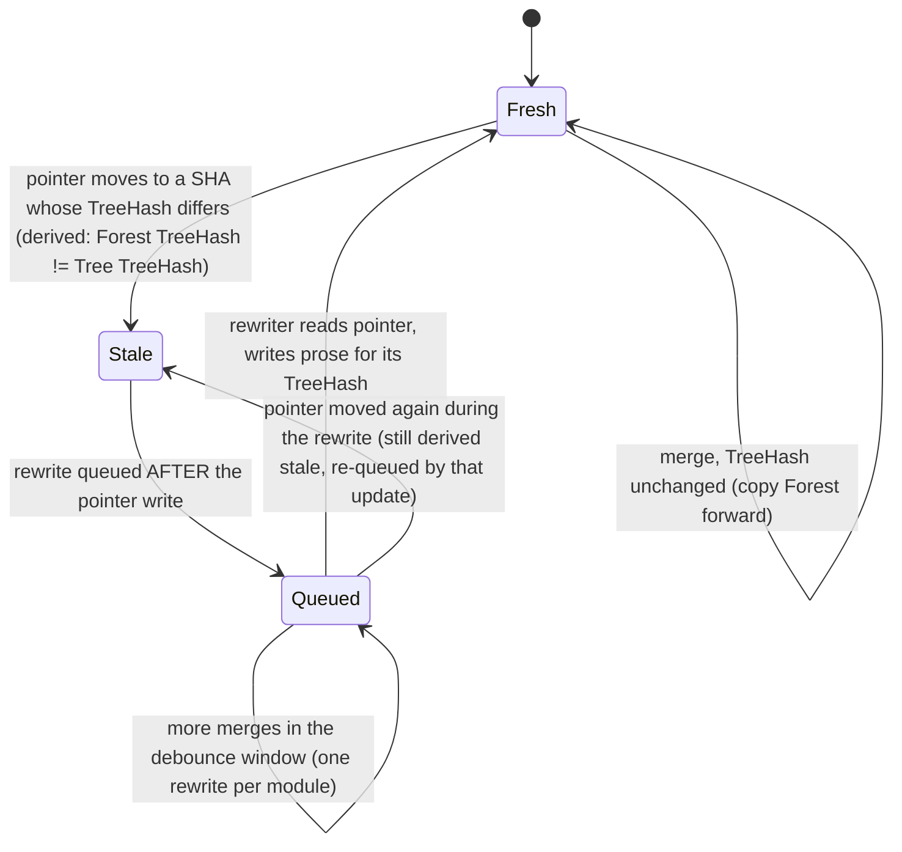
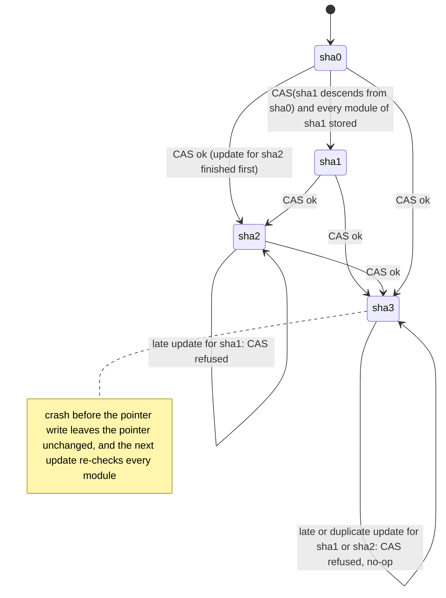

# SPIN model of `rco update`

This is a model of the update protocol described in `../../README.md`, in the sections "Fingerprints", "Incremental update after each merge" and "Verification". There is no rco code yet, so this checks the design, not an implementation.

- `rco_update.pml`: the model. Variants are chosen with `-D` switches (`GUARD`, `TOUCH`, `STALE`, `QAFTER`), and the property with `-DPROP=n`.
- `run.sh`: runs every property against every variant. Safety properties use `spin -a`, `gcc -DSAFETY`, `./pan`, and then `-DREACH ./pan -i` to get the shortest trail. Liveness properties use `gcc` and `./pan -a`. It writes `results/summary.txt` and `results/<variant>-P<n>/` (`pan.log` plus `trail-events.txt` for each failure).
- Tool: Spin Version 6.5.1 (20 December 2019).

## What is modeled

- **Default branch:** a linear history, sha0 to sha1 to sha2 to sha3. "NEW descends from P" (`git merge-base --is-ancestor P NEW`) is therefore `NEW >= P`.
- **Two modules, m0 and m1:**

  |    | sha0 | sha1 | sha2 | sha3 |
  |----|------|------|------|------|
  | m0 | c0   | c1 (contract change) | c1 | c1 |
  | m1 | c0   | c0   | c1 (internal change, same TreeHash) | c2 (contract change) |

- **Merger:** queues job `OLD->NEW` for each merge. It can also re-deliver one earlier job at any later point, which models a duplicate run such as a webhook retry alongside CI.
- **Two concurrent updaters:** they can interleave in any order, so updates race and old updates can finish late. Each one runs these steps:
  1. Map the changed modules.
  2. Re-extract their Trees into the content-addressed store.
  3. Mark the Forest stale and queue a prose rewrite when the TreeHash changed, or copy the Forest forward when it didn't.
  4. Write the `commit SHA -> module hashes` index entry.
  5. Write the pointer last.

  An updater can crash at any step before the pointer write (at most one crash per run).
- **One asynchronous Forest prose rewriter:** it reads the pointer, writes prose for that SHA's TreeHash, and clears the stale flag.

Variants:

| name | pointer write | modules touched | Forest stale | prose rewrite queued |
|---|---|---|---|---|
| **a** | naive: write if the value's index (hash) checks out (current README) | `git diff OLD NEW` only (README) | stored flag (README step 5) | in step 5, before the pointer write (README) |
| **b** | guarded, check then write: is-ancestor check, then a separate write | diff only | stored flag | before |
| **b-cas** | guarded, atomic: check and write as one compare-and-swap | diff only | stored flag | before |
| **fixed** | atomic guard | diff, **plus every module of NEW checked against the store** before the pointer write | **derived at read time:** Forest's TreeHash != Tree's TreeHash | **after** the pointer write |

## Results

These are from a full run of `./run.sh`. "States" is the number of states stored by the plain run; a failing run stops at the first error.

| property | a | b | b-cas | fixed |
|---|---|---|---|---|
| P1 pointer only moves forward | **FAIL** (2,067) | **FAIL** (2,385) | PASS (11,741,702) | PASS (6,317,937) |
| P2 published pointer has its Trees in the store | **FAIL** (146,110) | **FAIL** (176,314) | **FAIL** (122,070) | PASS (6,614,060) |
| P3 stale Forest never shown as current | **FAIL** (244) | **FAIL** (250) | **FAIL** (244) | PASS* (6,348,880) |
| P4 a duplicate run gives the same final state as one run | **FAIL** (2,142) | **FAIL** (2,462) | PASS (3,292,270) | PASS (2,425,936) |
| P5 no changed module skipped (after all updates finish) | **FAIL** (87) | **FAIL** (91) | **FAIL** (87) | PASS (361,769) |
| P6 liveness: pointer reaches the latest SHA and stays there | **FAIL** (3,268) | **FAIL** (3,898) | PASS (16,483,486) | PASS (8,498,083) |
| P7 (extra) liveness: every Forest eventually fresh | **FAIL** (385) | **FAIL** (393) | **FAIL** (385) | PASS (4,477,255) |

\* Under `fixed`, P3 holds by construction, because "shown as current" is defined as "Forest TreeHash == Tree TreeHash". That is the point of the fix: the pack computes staleness instead of trusting a flag.

Ablations: each row starts from b-cas and adds one fix, to show which fix closes which property.

| variant | P1 | P2 | P3 | P4 | P5 | P6 | P7 |
|---|---|---|---|---|---|---|---|
| b-cas + check every module | PASS | PASS | FAIL | PASS | PASS | PASS | FAIL |
| b-cas + derived staleness | PASS | FAIL | PASS | PASS | FAIL | PASS | FAIL |
| b-cas + queue the rewrite after the pointer | PASS | FAIL | FAIL | PASS | FAIL | PASS | PASS |

So each of the three extra fixes is needed, and each one closes exactly the properties listed.

The bounds are 3 merges, 2 modules, 2 updaters, at most 1 crash and at most 1 duplicate. P4 and P7 run with no crashes, and P5 runs with no duplicates. No run hit a depth or memory limit.

## Counterexamples in plain words

The shortest trail for each failure is in `results/<variant>-P<n>/trail-events.txt`.

- **P1, variant a (late finisher):** the update for sha1 does its work and pauses just before the pointer write. Meanwhile the update for sha2 finishes and sets the pointer to sha2. The sha1 update then wakes up and writes sha1, so the pointer has moved backwards. The naive hash check passes because sha1's index really is valid. It's just old.
- **P1, variant b (check then write isn't enough):** both updaters run the is-ancestor check while the pointer is still sha0, and both pass. The sha2 update writes first, then the sha1 update writes over it with its stale "yes". The guard only works if the check and the write happen as one atomic step, which is variant b-cas. That needs a compare-and-swap or conditional write in the storage backend, such as `git update-ref NEW OLD`, an atomic rename with a check, or a database conditional update.
- **P2, variants a, b and b-cas (trees not done for every module):** while the sha1 update is still extracting m0, the sha2 update runs. Its diff (sha1 to sha2) touches only m1, so it stores m1's Tree and publishes sha2. The pointer now names sha2, but m0's Tree for sha2 (content c1) isn't in the store yet. No crash is needed for this. The fix is to check every module hash of NEW against the store before the pointer write, which is a cheap `rev-parse` per module, and extract any that are missing. The diff only decides which modules get re-extracted first.
- **P3, variants a, b and b-cas (stored stale flag):** the same race as P2. The sha2 update's diff doesn't include m0, so it never marks m0's Forest stale. The pointer moves to sha2, where m0's contract differs from what its Forest describes, but the flag still says it's fresh. A second trail shows the rewriter's version of the same problem: it reads the pointer at sha0 and the pointer moves to sha1. The rewriter then writes prose for the old Tree and clears the stale flag. The fix is for `rco pack` to derive staleness by comparing the Forest's TreeHash with the Tree's TreeHash. ForestHash already contains TreeHash, so the data is there.
- **P4, variants a and b:** in the shortest trail, an old update (sha1) finishes after sha3 and leaves the pointer at sha1, so the final state differs from a single run. The duplicate itself is harmless: the store and the index are content-addressed sets. Once the pointer write is an atomic forward-only CAS, P4 passes.
- **P5, variants a, b and b-cas (crash loses a module):** the sha1 update crashes before extracting m0. Later updates diff sha1 to sha2 and sha2 to sha3, which never touch m0. All updates finish and the pointer reaches sha3, but m0's Tree for c1 was never built. Checking every module against the store (the P2 fix) also closes this.
- **P6, variants a and b:** the update for sha3 sets the pointer to sha3, then the late sha2 update overwrites it with sha2. No further work is queued, so the pointer stays behind forever.
- **P7, variants a, b and b-cas (Forest never refreshes):** the rewrite for m1 is queued in step 5, before the pointer write. The rewriter takes it while the pointer is still sha2 and writes prose for the old TreeHash. Then the pointer moves to sha3, and nothing re-queues m1, so its Forest stays stale for good. Queuing the rewrite after the pointer write fixes this, because the rewriter then always reads a pointer at least as new as the change.

## Note on fairness (P6, P7)

`run.sh` runs the liveness checks with `./pan -a` and without `-f`. Every process here does a bounded amount of work, so the only infinite runs are the stutter once everything has finished, and weak fairness holds on them trivially. With `-f`, SPIN 6.5.1 drops that final stutter and reported PASS on variant a even though a concrete run ends with the pointer behind (checked by hand). Using `-f` would hide real failures.

## Limits

- The history is linear. Rebased or force-pushed history, which the README's Verification section lists, isn't modeled. The next step would add a non-descendant SHA and check that the guard refuses it.
- The store and the index are modeled as never losing data, and partial writes inside one Tree aren't modeled.
- The debounced rewrite is modeled as one queue entry per contract change. Debouncing would only merge entries.
- Each pack read is atomic. A pack that reads the pointer and the Forest in separate steps would need a snapshot read, such as the Forest keyed by SHA.

## Forest freshness

## Pointer movement (fixed variant)

